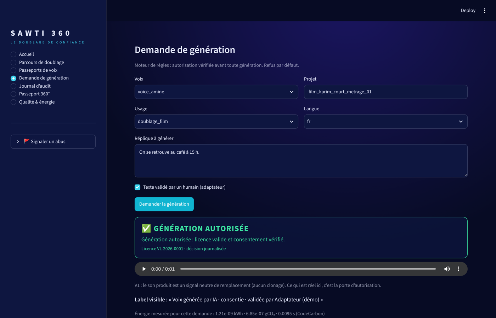
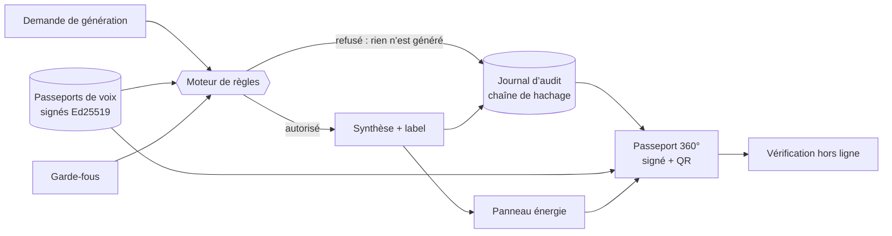

# Sawti 360 — Le doublage de confiance

> **Chaque voix a un passeport. Chaque film garde son identité.**
> Doublage supervisé de la derja vers le français, avec une couche de confiance qui vérifie le consentement des voix, journalise chaque décision et livre un **Passeport 360°** signé et vérifiable par QR.
>
> **« L’IA propose · L’humain décide · La confiance accompagne chaque export. »**

Projet de l’équipe pour le hackathon **IA Éthique 360 — 5e édition (JEI INSAT × OIF)**. Premier dépôt : 15 novembre 2026.

| | |
|---|---|
|  |  |
| ⛔ Voix sans consentement : **refusée**, rien n’est généré | ✅ Voix consentie : **acceptée**, label visible |
|  |  |
| ⛔ Après révocation de la licence : **refusée** | Passeport 360° signé, QR, vérification |

Captures prises sur la console réelle, avec des **données de démonstration** (aucune voix réelle).

---

## 1. Le problème

**Formulation** *(à ajuster au gabarit officiel du cahier)* : un cinéaste tunisien indépendant a besoin de faire voyager son film tourné en derja vers le public francophone, mais le doublage classique est hors de portée de son budget, et le doublage par IA existant ne lui garantit ni le consentement des voix, ni la fidélité du sens, ni la confidentialité d’un film inédit.

> « Un film incompris reste invisible ; les sous-titres aident un peu ; le doublage fait voyager un film. »
> — Mohamed Karim Dahmouni, cinéaste, entretien du 14 novembre 2026 *(accord écrit d’image et de voix : à obtenir)*

Trois verrous, tels que présentés dans notre vidéo :

1. **Barrière linguistique** — un film qu’on ne comprend pas ne voyage pas.
2. **Consentement** — à qui appartient la voix ? Qui l’a autorisée ?
3. **Transparence** — qu’a fait l’IA, et qui l’a validé ?

**Comment le problème a été détecté** (observer → écouter → vérifier → formuler) : journal dans [`docs/ENTRETIENS.md`](docs/ENTRETIENS.md). Un entretien réalisé ; les suivants sont `[à recueillir]`.

## 2. La solution

**Doublage supervisé** (8 étapes : import local → pistes → transcription → validation → traduction → fidélité → adaptation → voix) **+ couche de confiance** (Passeport de voix, consentement, contrôle humain, journal d’audit, sécurité) **+ Passeport 360°** à l’export.

| Ce que fait l’IA | Ce que l’IA ne décide pas |
|---|---|
| Propose une transcription, avec une confiance par segment | Le texte qui fait foi : le cinéaste le valide |
| Propose une traduction et signale les écarts (chiffres, noms, négations) | La réplique finale : l’adaptateur accepte, réécrit ou rejette |
| Génère une voix **uniquement** si le moteur de règles l’autorise | Qui peut prêter sa voix, pour quel usage, jusqu’à quand : le titulaire |
| Mesure sa propre énergie | L’export : le référent éthique valide le Passeport 360° |

## 3. Démo rapide

```bash
git clone https://github.com/youssefbesbes/Sawti360.git
```

```bash
cd Sawti360 && python -m venv .venv && source .venv/bin/activate
```

```bash
pip install -r requirements.txt
```

```bash
python scripts/seed_demo.py
```

```bash
streamlit run app/streamlit_app.py
```

```bash
pytest
```

Python 3.11+ ; tout fonctionne hors ligne, sur CPU.

**Le parcours de démo en 60 secondes**

| Temps | À l’écran | Page de la console | Principe | V1 |
|---|---|---|---|---|
| 0–10 s | Extrait chargé, transcription derja, score par langue | Parcours de doublage · Qualité & énergie | Diversité | 🟡 script WER prêt, valeur `[à mesurer]` |
| 10–25 s | Alerte de fidélité (« 15 h » devenu « 50 h »), correction, décision journalisée | Parcours de doublage › Fidélité | Contrôle humain, responsabilité | 🟡 aperçu à règles, réellement exécuté |
| 25–40 s | Voix non consentie → **refusée** ; voix consentie → **acceptée** | Demande de génération | Consentement, robustesse | ✅ |
| 40–50 s | Label visible, générique des voix, énergie | Demande de génération · Passeport 360° | Transparence, durabilité | ✅ |
| 50–60 s | QR → Passeport 360° vérifié ; **révocation → génération suivante refusée** | Passeport 360° · Passeports de voix | Toutes les portes | ✅ |

Vérification hors ligne d’un passeport exporté :

```bash
python scripts/verify_passport.py exports/passeport_360.json
```

Autres captures : [fidélité](docs/captures/02_fidelite.png) · [falsification du journal détectée](docs/captures/08_falsification.png) · [panneau énergie](docs/captures/09_energie.png). Présentation : voir [`docs/PITCH.md`](docs/PITCH.md).

## 4. Architecture



Diagrammes complets, flux de données et tableau « construit vs réutilisé » : [`docs/ARCHITECTURE.md`](docs/ARCHITECTURE.md).

```
sawti/        bibliothèque Python pure (règles, licences, audit, passeport, label, énergie, coffre…)
app/          console de démonstration Streamlit (en français)
scripts/      seed_demo.py · run_wer.py · verify_passport.py
tests/        34 tests ; génèrent results/attack_tests.md
docs/         ETHIQUE · DATASHEET · ARCHITECTURE · ENTRETIENS · RED_TEAM · PITCH
results/      uniquement des sorties mesurées
```

## 5. État d’avancement

✅ V1 (ce dépôt) · 🟡 demi-finale (21 nov.) · ⏳ finale (24–25 nov.) · 🔭 feuille de route

| Module | Statut | Précision |
|---|---|---|
| Passeport de voix (`licenses.py`) | ✅ | créer, signer, vérifier, révoquer ; SQLite |
| Moteur de règles (`rules.py`) | ✅ | fonction pure, 12 codes de décision, tous testés |
| Journal d’audit (`audit.py`) | ✅ | chaîne SHA-256, falsification détectée à l’index |
| Garde-fous (`guardrails.py`) | ✅ | voix non enregistrée, liste de blocage, signalement d’abus |
| Label, manifeste, générique (`label.py`) | ✅ | inspiré de C2PA, sans conformité revendiquée |
| Passeport 360° (`passport.py`) | ✅ | JSON + HTML + QR, signature Ed25519, vérification CLI |
| Panneau énergie (`energy.py`) | ✅ | CodeCarbon, valeurs mesurées uniquement |
| Coffre local (`vault.py`) | ✅ minimal | chiffrement au repos, rôles ; import vidéo 🟡 |
| Synthèse (`synth.py`) | ✅ porte / 🟡 voix | **la V1 produit un signal neutre de remplacement, pas une voix** ; la porte d’autorisation, elle, est réelle |
| Sawti-Bench, WER (`bench.py`, `run_wer.py`) | ✅ script / `[à mesurer]` | attend l’enregistrement de l’équipe |
| Vérificateur de fidélité (`fidelity.py`) | 🟡 | aperçu à règles (chiffres, noms, négations) ; rétro-traduction et évaluation à venir |
| Séparation des pistes, traduction + glossaire, mixage, sous-titres | 🟡 | non commencé |
| Shield, filigrane, intégrité des modèles, équipe rouge complète | ⏳ | |
| Amazigh, mode festival quasi direct, place de marché de voix | 🔭 | non construit |

## 6. Mesures

Règle du projet : **aucun résultat inventé**. Une valeur est mesurée par le code de ce dépôt, ou elle est `[à mesurer]`.

| Mesure | Valeur | Méthode |
|---|---|---|
| WER / CER derja (Whisper `small`) | `[à mesurer]` | `scripts/run_wer.py` : faster-whisper + jiwer, normalisation documentée dans `bench.normalize` |
| WER / CER français | `[à mesurer]` | idem |
| Tests automatisés | **34 / 34 réussis** | `pytest` (15 nov. 2026) |
| Scénarios d’attaque automatisés | **18 / 18 conformes à l’attendu** | [`results/attack_tests.md`](results/attack_tests.md), régénéré à chaque exécution |
| Énergie de 3 demandes de génération de la démo | **6,0 × 10⁻⁹ kWh · 3,4 × 10⁻⁶ gCO₂ · 0,015 s** | CodeCarbon hors ligne, mix électrique TUN — [`results/energy.json`](results/energy.json). Porte d’autorisation + signal de remplacement : **non représentatif d’une vraie synthèse** |
| Fidélité : précision / rappel sur 100 erreurs injectées | `[à mesurer]` | protocole demi-finale |
| Contrôle humain : taux de détection et temps de relecture avec / sans alertes | `[à mesurer]` | protocole demi-finale |
| Test d’écoute | `[à mesurer]` | |
| Shield : EER, faux positifs, faux négatifs | `[à mesurer]` | finale |

## 7. Démarche éthique à 360°

Détail, principes et rôle du référent : [`docs/ETHIQUE.md`](docs/ETHIQUE.md).

| Angle | Risque | Notre réponse | Limite résiduelle |
|---|---|---|---|
| **Les créateurs** | Voix clonée sans accord | Passeport de voix signé, refus par défaut, validation humaine exigée | Signature par la clé de la plateforme en V1 |
| **Les droits** | Usage hors contrat, voix de personnalités | Révocation, usages interdits, liste de blocage, signalement d’abus | La révocation n’efface pas l’audio déjà diffusé |
| **Les données** | Fuite d’un film inédit ou d’une empreinte vocale | Traitement local, coffre chiffré, rôles, suppression | Gestion de clés minimale |
| **Cultures et langues** | Derja mal comprise, références aplaties | Score par langue publié même mauvais, glossaire, validation du cinéaste | Jeu de test petit, WER `[à mesurer]` |
| **Transparence** | Le public ignore ce que l’IA a fait | Label, manifeste, générique, journal, Passeport 360° + QR | Pas de conformité C2PA ; un label peut être retiré |
| **La planète** | Modèles lourds sans compter | Énergie mesurée par tâche, plus petit modèle suffisant | CodeCarbon estime |

**Limites assumées** : la révocation ne retire pas un audio déjà diffusé · la détection de clone ne sera pas infaillible · le jeu de test est petit · un filigrane est retirable · aucune certification juridique (*alignement avec les textes cités, pas de certification ; relecture juridique prévue*) · en V1 la voix générée est un signal de remplacement.

## 8. Données et modèles

Chaque modèle et jeu de données, avec sa licence et son usage commercial : [`docs/DATASHEET.md`](docs/DATASHEET.md). Aucun modèle d’IA n’est exécuté dans le parcours V1 ; aucun audio de personne réelle n’est versionné ; le contenu d’un film ne quitte jamais la machine.

## 9. Équipe et répartition des tâches

| Rôle | Membre | Responsabilités |
|---|---|---|
| Chef d’équipe / référent éthique | `[prénom]` | coordination, `docs/ETHIQUE.md`, consentements, validation des passeports |
| IA parole | `[prénom]` | transcription, Sawti-Bench, synthèse, Shield |
| IA langue | `[prénom]` | traduction, glossaire, vérificateur de fidélité |
| Back-end & sécurité | `[prénom]` | moteur de règles, journal, passeport, coffre, équipe rouge |
| Front-end / audio / communication | `[prénom]` | console, mixage, vidéo, pitch |

## 10. Feuille de route

| Date | Jalon |
|---|---|
| **15 nov.** | Premier dépôt : V1 de la couche de confiance (ce dépôt) |
| **18 nov.** | Ateliers : retours consignés dans `docs/RETOURS_WORKSHOPS.md` |
| **21 nov.** | Demi-finale : parcours complet sur 1–2 min d’extrait (avec accord écrit), Sawti-Bench v1, fidélité évaluée |
| **24 nov.** | Dépôt final : équipe rouge, Shield, filigrane, intégrité des modèles |
| **25 nov.** | Grande finale : prototype fonctionnel, mode hors ligne, sauvegarde USB |

## 11. Ce que l’équipe doit encore fournir

- `data/bench/derja_01.wav` + `derja_01.txt` (≈ 2 min, voix consentie), puis `python scripts/run_wer.py`
- Formulaires de consentement signés dans `data/consents/` ; accord écrit de Mohamed Karim Dahmouni
- Entretiens 2 à 4 dans `docs/ENTRETIENS.md` ; vérification des prix et sélections cités
- Prénoms de l’équipe (tableau ci-dessus) et nom du référent éthique
- Liste de blocage réelle dans `data/blocklist.json`

## 12. Propriété intellectuelle

L’équipe conserve la propriété intellectuelle du projet ; l’OIF dispose d’un droit de premier regard, conformément au cahier des charges. Les voix ne sont utilisées qu’avec consentement écrit, dans la limite de leur Passeport de voix. Licences des dépendances : [`docs/DATASHEET.md`](docs/DATASHEET.md). Licence du code : `[à définir par l’équipe]`.
