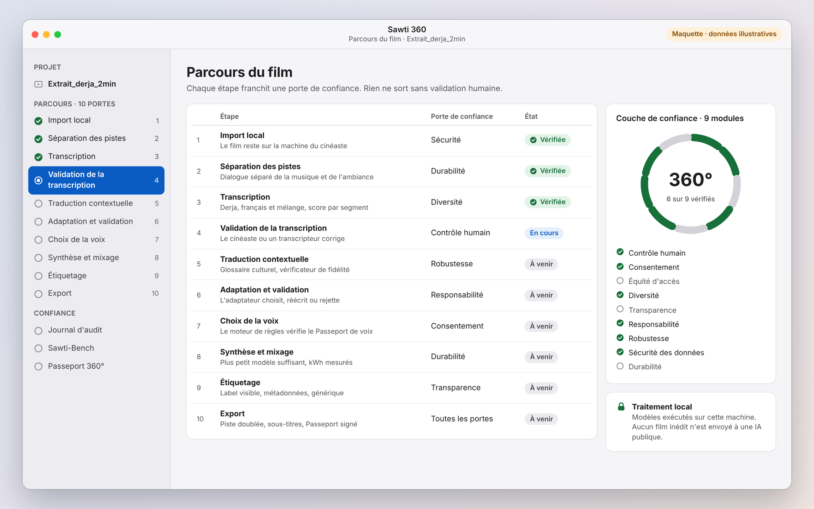
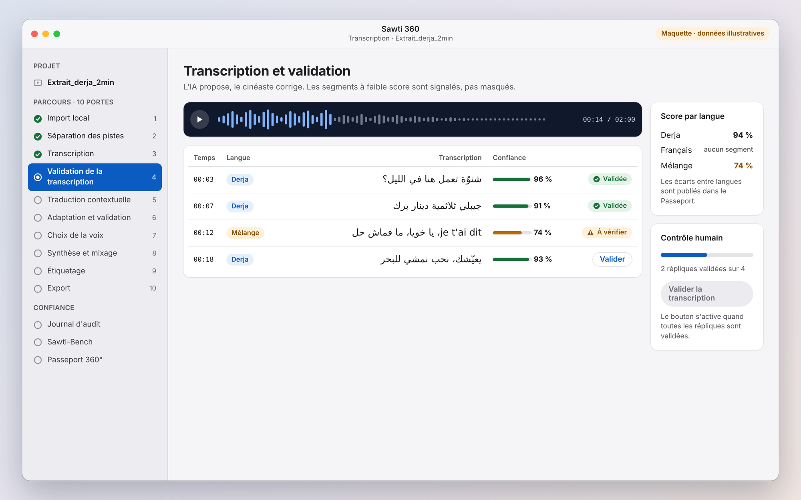
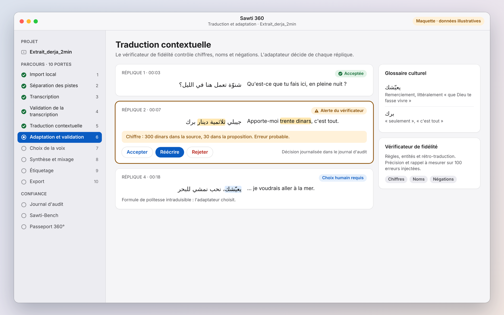
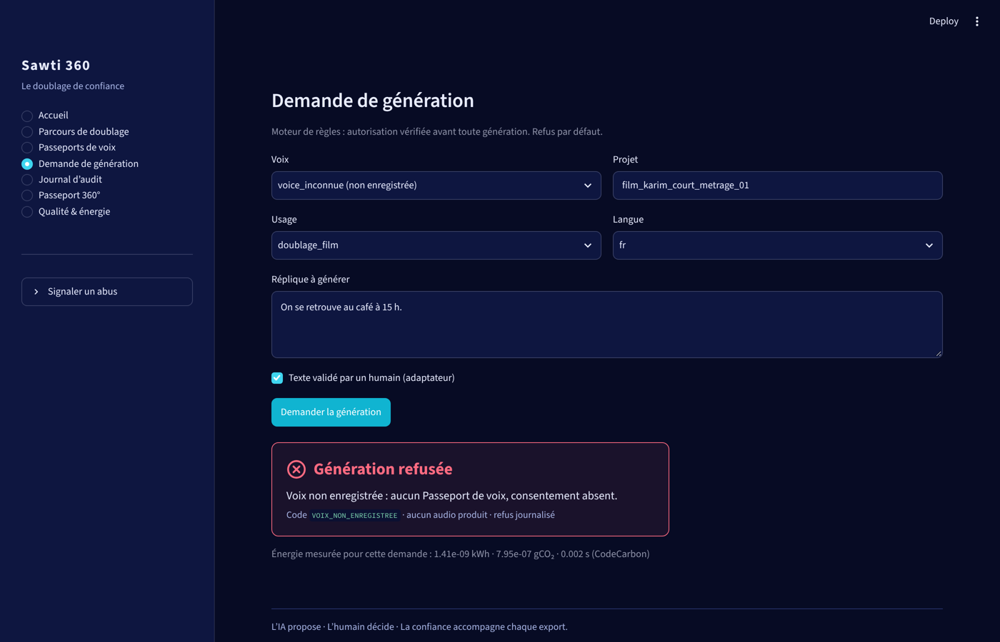
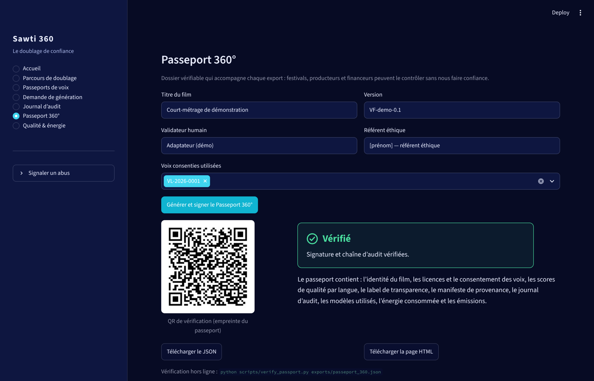
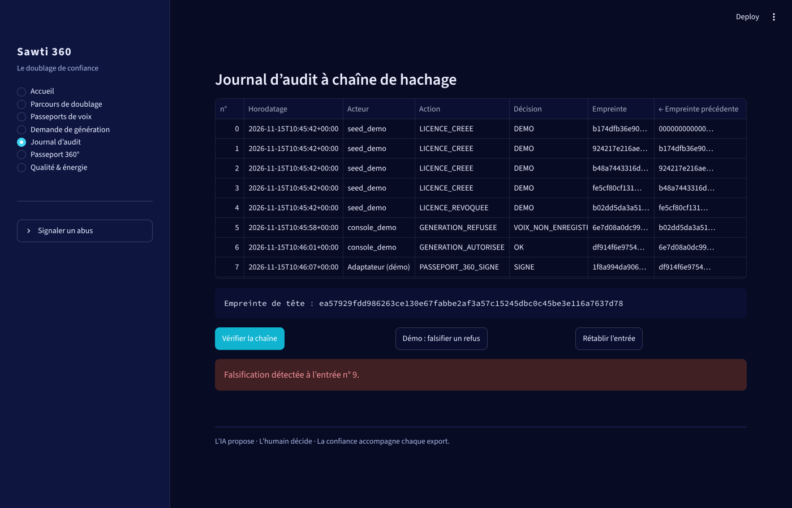
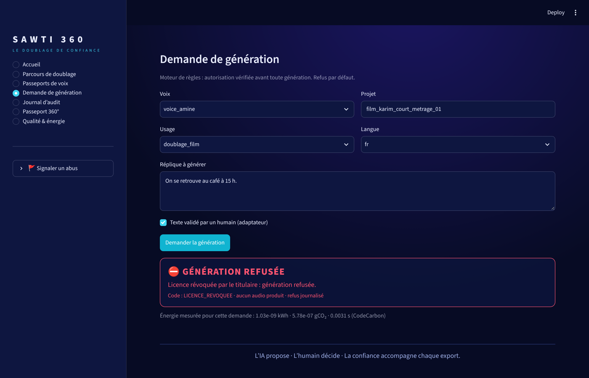
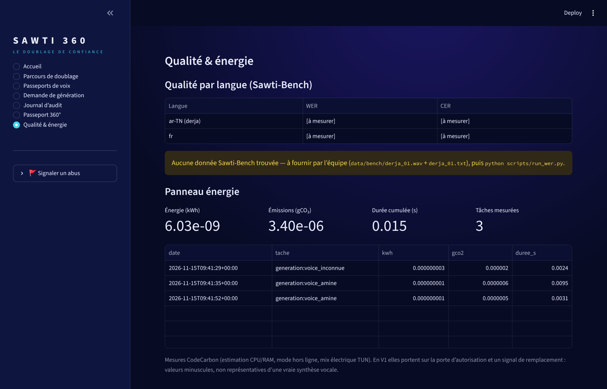
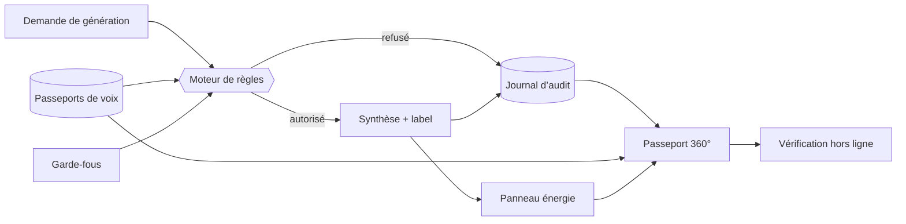

# Sawti 360 — Le doublage de confiance

Sawti 360 double un film de la derja vers le français, sous le contrôle du cinéaste. Chaque voix utilisée a un Passeport de voix signé par son titulaire, chaque décision est journalisée, et le film exporté part avec un Passeport 360° que n'importe qui peut vérifier.

« L’IA propose · L’humain décide · La confiance accompagne chaque export. »

Projet de l'équipe Houma Skhouna, présenté au hackathon IA Éthique 360, 5e édition, organisé par la Junior Entreprise INSAT (JEI, mandat 2026/2027) avec l'OIF. Sous-thématique : l'intégration de l'intelligence artificielle dans l'industrie audiovisuelle à vocation culturelle. Premier dépôt : 15 novembre 2026. Tout le dépôt est rédigé en français.


*Maquette de l'interface cible (voir [Aperçu du prototype](#aperçu-du-prototype)). Les données y sont illustratives et aucune voix réelle n'y figure.*

## Sommaire

- [Où trouver chaque critère du cahier des charges](#où-trouver-chaque-critère-du-cahier-des-charges)
- [Le problème](#le-problème)
- [La solution](#la-solution)
- [Aperçu du prototype](#aperçu-du-prototype)
- [Le Passeport 360° du film](#le-passeport-360-du-film)
- [Place de l'IA : construit ou réutilisé](#place-de-lia--construit-ou-réutilisé)
- [Lancer la démo](#lancer-la-démo)
- [Démo de 60 secondes](#démo-de-60-secondes)
- [Architecture](#architecture)
- [État d'avancement](#état-davancement)
- [Mesures](#mesures)
- [Démarche éthique à 360°](#démarche-éthique-à-360)
- [En cohérence avec la Francophonie](#en-cohérence-avec-la-francophonie)
- [Modèle économique](#modèle-économique)
- [Design de l'interface](#design-de-linterface)
- [Données et modèles](#données-et-modèles)
- [Équipe](#équipe)
- [Feuille de route](#feuille-de-route)
- [Ce qu'il nous reste à fournir](#ce-quil-nous-reste-à-fournir)
- [Propriété intellectuelle](#propriété-intellectuelle)
- [Sources](#sources)

## Où trouver chaque critère du cahier des charges

Première soumission du 15 novembre, avec les pondérations du cahier des charges.

| Critère (poids) | Où le lire dans ce dépôt |
|---|---|
| Pertinence du problème détecté (30 %) | [Le problème](#le-problème), [docs/ENTRETIENS.md](docs/ENTRETIENS.md) |
| Innovation et place de l'IA (25 %) | [La solution](#la-solution), [Place de l'IA](#place-de-lia--construit-ou-réutilisé) |
| Démarche éthique à 360° (25 %) | [Démarche éthique à 360°](#démarche-éthique-à-360), [docs/ETHIQUE.md](docs/ETHIQUE.md) |
| Faisabilité et intention de développement (20 %) | [Lancer la démo](#lancer-la-démo), [État d'avancement](#état-davancement), [Feuille de route](#feuille-de-route), [Équipe](#équipe) |
| Livrables : README en français avec section éthique, code même incomplet | Ce fichier, `sawti/`, `app/`, `scripts/`, `tests/` |
| Propriété intellectuelle : droits d'auteur, voix, licences | [Propriété intellectuelle](#propriété-intellectuelle), [Données et modèles](#données-et-modèles) |
| Pour les phases suivantes : prototype, éthique, impact francophone, pitch, viabilité | [Aperçu du prototype](#aperçu-du-prototype), [Francophonie](#en-cohérence-avec-la-francophonie), [Modèle économique](#modèle-économique), [docs/PITCH.md](docs/PITCH.md) |

## Le problème

Un cinéaste tunisien indépendant rencontre une barrière de langue qui empêche ses films en derja d'être compris quand ils sont présentés à des festivals ou à des publics étrangers, ce qui entraîne des films primés mais invisibles. Les outils d'IA qui pourraient les doubler lui font courir un autre risque : voix clonées sans accord, contenus non étiquetés, aucune trace de qui a décidé quoi.

**Face 1 : le film ne voyage pas.** Le témoin est Mohamed Karim Dahmouni, cinéaste amateur tunisien (accord écrit d'image et de voix : à obtenir, prix et sélections : à vérifier avec justificatifs).

> « Un film incompris reste invisible ; les sous-titres aident un peu ; le doublage fait voyager un film. »
> Mohamed Karim Dahmouni, cinéaste, entretien du 14 novembre 2026

**Face 2 : le doublage par IA est un terrain de conflits.** Les fiches du programme AI Academy citent des cas réels : en France, la voix d'un doubleur décédé recréée par IA pour une bande-annonce alors que sa famille n'avait accepté qu'un essai, puis 25 doubleurs qui obtiennent le retrait de 47 modèles clonant leur voix ; des doublages d'anime par IA mis en ligne puis retirés en quelques jours ; une voix synthétique dans un documentaire sans mention à l'écran. La technique seule ne suffit pas : il faut du consentement, de la transparence et de la responsabilité.

**Comment nous l'avons détecté.** Observer, écouter, vérifier, formuler. Le journal des entretiens est dans [docs/ENTRETIENS.md](docs/ENTRETIENS.md). Un seul entretien est fait à ce jour, les autres (programmateur de festival, doubleur ou sous-titreur, traducteur ou adaptateur, producteur ou autre cinéaste) sont marqués `[à recueillir]`. Pour étayer le manque, nous mesurerons le taux d'erreur (WER) d'un modèle existant sur 2 minutes de derja transcrites à la main : `[à mesurer]`.

## La solution

Sawti 360 est un doublage supervisé entouré d'une couche de confiance. Les outils de doublage par IA produisent une voix. Sawti 360 produit une voix et la preuve qu'elle est légitime, mesurée et traçable.

### Le parcours d'un film : dix étapes, dix portes de confiance

| # | Étape | Ce qui se passe | Porte de confiance |
|---|---|---|---|
| 1 | Import local | Le cinéaste charge un extrait ; rien ne quitte sa machine | Sécurité |
| 2 | Séparation des pistes | Dialogue séparé de la musique et de l'ambiance | Durabilité |
| 3 | Transcription | Derja, français et mélange, score de confiance par segment | Diversité |
| 4 | Validation de la transcription | Le cinéaste ou un transcripteur corrige | Contrôle humain |
| 5 | Traduction contextuelle | Propositions avec glossaire culturel, vérificateur de fidélité (chiffres, noms, négations) | Robustesse |
| 6 | Adaptation et validation | L'adaptateur accepte, réécrit ou rejette chaque réplique | Responsabilité |
| 7 | Choix de la voix | Voix neutre ou consentie ; le moteur de règles vérifie le Passeport de voix | Consentement |
| 8 | Synthèse et mixage | Voix générée avec le plus petit modèle suffisant | Durabilité |
| 9 | Étiquetage | Label visible, métadonnées, générique des voix | Transparence |
| 10 | Export | Piste doublée, sous-titres et Passeport 360° signé | Toutes les portes |

L'état de réalisation de chaque étape est dans [État d'avancement](#état-davancement).

### Les neuf modules de la couche de confiance

| Principe | Module Sawti 360 | Ce que fait le module |
|---|---|---|
| Contrôle humain | Validation et bouton d'arrêt | Validation de chaque réplique ; rien ne sort sans validation |
| Consentement | Passeport de voix et moteur de règles | Registre des consentements (qui, quel usage, combien de temps, quelle rémunération, droit de retrait) ; refus de toute génération hors licence |
| Équité d'accès | Équité d'accès | Mesure des écarts par accent régional ; version gratuite pour étudiants et petites structures |
| Diversité | Sawti-Bench | Test en français, derja, arabe, amazigh si des données existent ; publication des écarts, même mauvais |
| Transparence | Label et générique des voix | Label visible, manifeste lisible par machine de type C2PA, générique, QR de vérification |
| Responsabilité | Journal d'audit et référent éthique | Journal à chaîne de hachage, référent éthique nommé, voie de recours |
| Robustesse | Garde-fous et équipe rouge | Blocage des voix non enregistrées et des personnalités, tests d'attaque, bouton de signalement |
| Sécurité des données | Coffre local | Traitement local, chiffrement, accès par rôle, jamais de film inédit envoyé à une IA publique |
| Durabilité | Panneau énergie | kWh et gCO₂ par génération, mode éco avec le plus petit modèle suffisant |

Les fiches 1 et 3 du programme ne nous ont pas été transmises : « contrôle humain » et « équité d'accès » sont une hypothèse de notre part.

| Ce que fait l'IA | Ce qu'elle ne décide pas |
|---|---|
| Elle propose une transcription | Le cinéaste valide le texte qui fait foi |
| Elle propose une traduction et signale les écarts de chiffres, de noms, de négations | L'adaptateur accepte, réécrit ou rejette chaque réplique |
| Elle génère une voix si le moteur de règles l'autorise | Le titulaire fixe les usages, les projets et la durée, et peut révoquer |
| Elle mesure sa consommation | Le référent éthique valide le passeport avant l'export |

## Aperçu du prototype

Ces huit écrans sont des **maquettes de l'interface cible**, conçues avec les principes de l'Apple Human Interface Guidelines (voir [Design de l'interface](#design-de-linterface)). Les données y sont illustratives, la bannière « Maquette · données illustratives » est présente sur chaque image. Les captures de la console réellement exécutable (Streamlit) sont plus bas.

### 1. Parcours du film
Les dix portes de confiance et l'anneau des neuf modules. Rien ne sort sans validation humaine.



### 2. Transcription et validation
Score de confiance par segment et par langue ; les segments faibles sont signalés, pas masqués. Le bouton de validation reste inactif tant que le cinéaste n'a pas tout validé.



### 3. Traduction contextuelle et vérificateur de fidélité
Le vérificateur détecte ici un chiffre qui change (300 dinars devenus 30). L'adaptateur accepte, réécrit ou rejette, et sa décision est journalisée. Le glossaire culturel signale les expressions intraduisibles.



### 4. Passeport de voix et moteur de règles
Une voix non enregistrée est refusée, une voix consentie est acceptée. La révocation bloque les générations futures ; l'audio déjà diffusé ne peut pas être retiré, et l'interface le dit.


### 5. Export : label, générique et énergie
Label « doublé avec IA » visible, générique des voix (humaine, consentie, neutre), manifeste de provenance et comparaison énergétique de deux modèles.


### 6. Passeport 360°
Le dossier vérifiable par QR : identité, voix, langues, transparence, responsabilité, sécurité, durabilité, signature. Le QR de cette maquette pointe vers ce dépôt.


### 7. Journal d'audit à chaîne de hachage
Chaque entrée contient l'empreinte de la précédente. Les empreintes de la maquette sont de vrais SHA-256 calculés sur les six entrées affichées.


### 8. Sawti-Bench
Évaluation par langue. Aucune valeur n'est inventée : les barres en pointillés se remplissent quand les mesures existent.


### Captures de la console actuelle (Streamlit, données de démonstration)

| Refus : voix non enregistrée | Accord : voix consentie |
|---|---|
|  |  |
| **Passeport 360° signé et vérifié** | **Falsification détectée dans le journal** |
|  |  |
| **Refus après révocation** | **Panneau énergie** |
|  |  |

Autre capture : [vérificateur de fidélité](docs/captures/02_fidelite.png).

## Le Passeport 360° du film

À chaque export, Sawti 360 génère un dossier lisible par un humain et vérifiable par une machine. Un festival, un producteur ou un financeur peut le contrôler avec un QR, sans nous croire sur parole.

| Rubrique | Contenu |
|---|---|
| Identité | Titre, version, date, hash du film exporté |
| Voix | Pour chaque voix : humaine, consentie ou neutre ; identifiant de licence ; usages autorisés ; durée ; état (valide ou révoqué) |
| Langues | Scores de qualité par langue et par accent testé ; écarts publiés |
| Transparence | Label, manifeste de provenance, mention des passages générés par l'IA |
| Responsabilité | Référent éthique, validateur, empreinte de tête du journal d'audit, nombre de refus de génération |
| Sécurité | Versions et empreintes des modèles utilisés, traitement local confirmé |
| Durabilité | kWh et gCO₂ pour le film, modèles comparés |
| Signature | Signature numérique et QR de vérification |

## Place de l'IA : construit ou réutilisé

| Composant | Réutilisé ou construit | Évaluation prévue |
|---|---|---|
| Transcription derja et français | Réutilisé comme base (Whisper, optionnel) ; adaptation légère si les données le permettent | WER avant et après, par langue, sur Sawti-Bench |
| Traduction contextuelle | Réutilisé, plus un glossaire construit avec des traducteurs | Notes de bilingues sur 30 segments `[à mesurer]` |
| Vérificateur de fidélité | Construit : règles, entités, rétro-traduction | Précision et rappel sur 100 erreurs injectées |
| Moteur de consentement | Construit : licences signées et règles | Tests d'attaque, refus attendus |
| Détection de clone (Shield) | À construire sur des empreintes vocales pré-entraînées | Taux d'erreur sur clones de test, publié |
| Voix | Réutilisé (licence vérifiée), voix neutre ou consentie | Écoute de 15 à 20 personnes `[à mesurer]` |
| Filigrane et manifeste | Filigrane open source réutilisé ; manifeste construit | Robustesse après compression et bruit |
| Panneau énergie | CodeCarbon réutilisé | kWh et gCO₂ par minute de film |

La licence de chaque modèle et de chaque jeu de données est vérifiée avant utilisation (voir [Données et modèles](#données-et-modèles)). L'IA est au cœur de la solution, mais l'humain garde la décision à chaque étape.

## Lancer la démo

Il faut Python 3.11 ou plus récent. Tout tourne hors ligne, sur CPU.

```bash
git clone https://github.com/youssefbesbes/Sawti360.git
```

```bash
cd Sawti360 && python -m venv .venv && source .venv/bin/activate
```

```bash
pip install -r requirements.txt
```

```bash
python scripts/seed_demo.py
```

```bash
streamlit run app/streamlit_app.py
```

Le parcours à montrer en une minute :

1. Page « Demande de génération », voix `voice_inconnue` : refus, aucun audio n'est produit.
2. Même page, voix `voice_amine` : accord, avec le label visible et l'énergie mesurée.
3. Page « Passeport 360° » : générer, lire le QR, vérifier.
4. Page « Passeports de voix » : révoquer la licence d'Amine.
5. Retour à « Demande de génération » avec `voice_amine` : refus.

On peut aussi falsifier une entrée dans « Journal d’audit » et constater que la vérification échoue à cette entrée ([capture](docs/captures/08_falsification.png)).

Pour vérifier un passeport exporté sans ouvrir la console :

```bash
python scripts/verify_passport.py exports/passeport_360.json
```

Les tests :

```bash
pytest
```

Les diapositives du pitch sont sur Canva : https://canva.link/lu6nsgxbyjwdj6h (plan dans [docs/PITCH.md](docs/PITCH.md)).

## Démo de 60 secondes

| Seconde | Ce qu'on voit | Principe démontré |
|---|---|---|
| 0 à 10 | Karim charge un extrait ; transcription derja et score par langue | Diversité |
| 10 à 25 | Alerte du vérificateur ; l'adaptateur corrige ; décision journalisée | Contrôle humain, responsabilité |
| 25 à 40 | Demande de voix non consentie : refusée. Voix consentie d'un coéquipier : acceptée | Consentement, robustesse |
| 40 à 50 | Export avec label visible, générique des voix et énergie affichée | Transparence, durabilité |
| 50 à 60 | Scan du QR : le Passeport 360° s'ouvre et se vérifie. Révocation de la licence : la génération suivante est refusée | Toutes les portes |

Ce que la console actuelle permet déjà de montrer est décrit dans [Lancer la démo](#lancer-la-démo).

## Architecture



Le code métier est dans `sawti/`, sans dépendance à l'interface. `app/` contient la console Streamlit, `scripts/` les trois commandes (données de démo, mesure du WER, vérification d'un passeport), `tests/` les 34 tests, `results/` les sorties mesurées. Les schémas détaillés, les flux de données et ce que nous avons écrit ou réutilisé sont dans [docs/ARCHITECTURE.md](docs/ARCHITECTURE.md).

## État d'avancement

| Module | État | Remarque |
|---|---|---|
| Passeport de voix (`licenses.py`) | fait | création, signature Ed25519, vérification, révocation |
| Moteur de règles (`rules.py`) | fait | fonction pure, 12 codes de décision, un test par code |
| Journal d'audit (`audit.py`) | fait | chaîne SHA-256, falsification localisée |
| Garde-fous (`guardrails.py`) | fait | voix inconnue, liste de blocage, signalement d'abus |
| Label, manifeste, générique (`label.py`) | fait | inspiré de C2PA, sans prétendre à la conformité |
| Passeport 360° (`passport.py`) | fait | JSON, HTML, QR, vérification en ligne de commande |
| Panneau énergie (`energy.py`) | fait | CodeCarbon |
| Coffre local (`vault.py`) | fait, minimal | chiffrement et rôles ; pas encore branché à l'import vidéo |
| Synthèse (`synth.py`) | porte faite, voix à venir | voir la note ci-dessous |
| Mesure du WER (`bench.py`, `run_wer.py`) | script prêt | il manque l'enregistrement |
| Vérificateur de fidélité (`fidelity.py`) | aperçu | règles sur les chiffres, les noms et les négations |
| Séparation des pistes, traduction, mixage, sous-titres | demi-finale | pas commencé |
| Shield, filigrane, intégrité des modèles, équipe rouge complète | finale | |
| Amazigh, mode festival, place de marché de voix | feuille de route | nous ne les construisons pas |

Note sur la synthèse : dans cette version, une génération autorisée produit un bip d'une seconde, pas une voix. Ce que nous montrons pour l'instant, c'est que rien n'est généré sans licence valide. La vraie synthèse arrive pour la demi-finale.

## Mesures

Un chiffre de ce dépôt est soit mesuré par le code, soit noté `[à mesurer]`.

| Mesure | Valeur | Comment |
|---|---|---|
| WER et CER en derja, Whisper `small` | `[à mesurer]` | `scripts/run_wer.py`, normalisation décrite dans `bench.normalize` |
| WER et CER en français | `[à mesurer]` | idem |
| Tests | 34 sur 34 | `pytest`, 15 novembre 2026 |
| Scénarios d'attaque automatisés | 18 sur 18 conformes | [results/attack_tests.md](results/attack_tests.md), régénéré à chaque exécution |
| Énergie de trois demandes de génération | 6,0 × 10⁻⁹ kWh, 3,4 × 10⁻⁶ gCO₂, 0,015 s | CodeCarbon hors ligne, [results/energy.json](results/energy.json) |
| Fidélité, précision et rappel sur 100 erreurs injectées | `[à mesurer]` | demi-finale |
| Détection d'erreurs avec et sans alertes | `[à mesurer]` | demi-finale |
| Test d'écoute | `[à mesurer]` | |
| Shield : taux d'erreur | `[à mesurer]` | finale |

La mesure d'énergie ne porte que sur la porte d'autorisation et le bip. Elle ne dit rien du coût d'une vraie synthèse vocale.

## Démarche éthique à 360°

Le détail est dans [docs/ETHIQUE.md](docs/ETHIQUE.md). En résumé, pour chacun des six angles du cahier :

**Les créateurs.** Le risque est qu'une voix soit clonée sans accord. Aucune voix n'est générée sans Passeport de voix, et le texte doit avoir été validé par un humain. Limite : la licence est aujourd'hui signée par la clé de la plateforme, pas par celle du titulaire.

**Les droits.** Le risque est l'usage hors contrat, ou la voix d'une personnalité. Le titulaire liste les usages interdits et peut révoquer ; une liste de blocage refuse les personnalités ; un bouton permet de signaler un abus. Limite : révoquer n'efface pas un audio déjà diffusé.

**Les données.** Le risque est la fuite d'un film inédit ou d'une empreinte vocale. Tout est traité en local, dans un coffre chiffré avec des rôles. Limite : la clé du coffre est un simple fichier.

**Cultures et langues.** Le risque est une IA qui comprend mal la derja. Nous publions un score par langue, même mauvais, et le cinéaste valide la transcription. Limite : notre jeu de test est petit et le score en derja n'est pas encore mesuré.

**Transparence.** Le risque est que le public ignore ce que l'IA a fait. Le film porte un label, un manifeste de provenance et un générique des voix. Limite : un label se retire d'une copie, et notre manifeste n'est pas certifié C2PA.

**La planète.** Le risque est d'utiliser de gros modèles sans compter. Chaque tâche est mesurée et le résultat figure dans le passeport. Limite : CodeCarbon donne une estimation.

Deux principes des fiches du mentor ne nous ont pas été transmis. Nous les avons traités comme « contrôle humain » et « équité » ; c'est une hypothèse.

Ce dépôt s'aligne sur les textes cités. Il n'a reçu aucune certification, et une relecture juridique est prévue. La détection de clone, quand elle existera, ne sera pas infaillible, et un filigrane audio peut être retiré.

## En cohérence avec la Francophonie

**Diversité culturelle et linguistique.** Le projet part de la derja, une langue que les outils de reconnaissance vocale traitent mal, et va vers le français. Nous mesurons la qualité langue par langue pour que l'écart soit visible. L'amazigh est sur la feuille de route.

**Jeunesse et entrepreneuriat.** Le Passeport de voix prévoit une rémunération par usage pour le comédien. Le montant et le modèle économique restent `[à définir]`.

**Inclusion et égalité.** L'outil vise les jeunes créateurs et les petites structures, qui n'ont pas accès à un studio de doublage. L'export prévoit des sous-titres français, utiles aux personnes sourdes ou malentendantes. Ils ne sont pas encore implémentés.

**Un numérique au service de l'humain.** Le consentement, les droits du titulaire et la liberté du cinéaste passent avant la génération : le moteur de règles refuse par défaut.

## Modèle économique

Business Model Canvas (version de première soumission ; prix `[à définir]`).

| Bloc | Contenu |
|---|---|
| Segments | Cinéastes et producteurs indépendants, festivals, ciné-clubs, chaînes locales, plateformes, comédiens de doublage |
| Proposition de valeur | Faire voyager un film en derja avec contrôle humain et un Passeport 360° que festivals et financeurs peuvent vérifier ; protection des voix pour les comédiens |
| Canaux | Festivals, écoles de cinéma, réseau INSAT, réseaux francophones, communauté en ligne |
| Relation clients | Accompagnement à la première utilisation, glossaire partagé, retours intégrés |
| Revenus | Abonnement ou paiement à la minute de film ; offre festival ; offre gratuite pour étudiants et associations ; rémunération par usage reversée aux voix |
| Ressources clés | Modèles adaptés au derja, Sawti-Bench, glossaires, registre de voix consenties, équipe produit et ML |
| Activités clés | Développement, annotation, évaluation, tests d'attaque, partenariats |
| Partenaires | Adaptateurs, traducteurs, comédiens, festivals, studios, OIF, établissements d'enseignement |
| Coûts | Calcul, rémunération des humains qui valident, licences, hébergement sécurisé |

## Design de l'interface

Les maquettes suivent les [Human Interface Guidelines d'Apple](https://developer.apple.com/design/human-interface-guidelines/) pour une application de bureau, avec la méthode du skill de design Apple : accessibilité d'abord, conventions de plateforme ensuite, puis identité.

- **Thèse de l'écran** : montrer, à chaque étape, quelle porte de confiance est franchie. Chaque écran affiche ce que l'IA a proposé et ce que l'humain a décidé.
- **Signature** : l'anneau à neuf segments, un par module de confiance. Il se remplit à mesure que les modules sont vérifiés et devient l'emblème du Passeport 360°. Sa structure encode une information réelle, pas une décoration.
- **Conventions macOS** : fenêtre redimensionnable, barre latérale à deux niveaux au plus, parcours numéroté, boutons arrondis avec une action principale par vue, texte de 13 px au minimum.
- **Couleurs** : un sens par couleur. Vert pour valide ou consenti, rouge pour refusé, orange pour à vérifier, bleu pour l'action et l'étape en cours. L'état n'est jamais porté par la couleur seule : chaque pastille a un texte et une icône.
- **Contraste** (calculé sur les valeurs hexadécimales) : texte principal `#1D1D1F` sur `#F5F5F7` 15,5:1 ; texte secondaire `#58585D` sur `#F5F5F7` 6,5:1 ; vert `#17703A` sur `#E3F3E8` 5,3:1 ; rouge `#B8241B` sur `#FCE9E7` 5,4:1 ; orange `#8A4F00` sur `#FFF1D9` 5,9:1 ; blanc sur bleu `#0A5CC2` 6,3:1. Tous dépassent le seuil de 4,5:1.
- **Typographie** : une seule famille (Inter, proche de la police système), poids moyen à gras pour la hiérarchie, texte derja en écriture arabe de droite à gauche.
- **Honnêteté** : bannière « Maquette · données illustratives » sur chaque image, et aucune mesure inventée dans Sawti-Bench.

Limites : ces écrans sont des maquettes HTML rendues en images, pas l'interface Streamlit actuelle. Les contrastes ont été calculés mais pas audités sur un rendu réel, et le comportement avec un texte agrandi, le mode sombre et le lecteur d'écran ne sont pas testés.

Les sources sont dans [design/](design/) : `python design/generer_maquettes.py` régénère les HTML et les PNG (dépendances : reportlab, playwright, pillow, Chrome).

## Données et modèles

La liste des modèles et des jeux de données, avec leur licence, est dans [docs/DATASHEET.md](docs/DATASHEET.md). Cette version n'exécute aucun modèle d'IA dans le parcours de démo. Le dépôt ne contient aucun enregistrement d'une personne réelle.

## Équipe

| Rôle | Membre | Ce dont il ou elle s'occupe |
|---|---|---|
| Chef d'équipe, référent éthique | `[prénom]` | coordination, consentements, validation des passeports |
| IA parole | `[prénom]` | transcription, Sawti-Bench, synthèse, Shield |
| IA langue | `[prénom]` | traduction, glossaire, fidélité |
| Back-end et sécurité | `[prénom]` | règles, journal, passeport, coffre, équipe rouge |
| Front-end, audio, communication | `[prénom]` | console, mixage, vidéo, pitch |

## Feuille de route

| Échéance | À démontrer |
|---|---|
| 15 novembre, 23 h 59 (première soumission) | Passeport de voix et moteur de règles (refus et accord), label et manifeste, journal d'audit, panneau énergie, script de mesure du WER, ce README |
| 18 novembre | Ateliers ; les retours iront dans `docs/RETOURS_WORKSHOPS.md` |
| 21 novembre (demi-finale) | Parcours complet sur un extrait d'une à deux minutes : transcription, traduction, validation, voix, export, Passeport 360°, avec l'accord écrit du cinéaste |
| 24 novembre (dernière soumission) | Dépôt final : Sawti-Bench publié, équipe rouge, Shield, filigrane, Passeport complet, Business Model Canvas |
| 25 novembre (finale) | Prototype utilisable hors ligne |
| Suite | Amazigh, mode quasi-direct supervisé pour festivals, place de marché de voix sous licence : annoncés comme vision, pas comme acquis |

## Ce qu'il nous reste à fournir

- Un enregistrement de deux minutes en derja et sa transcription (`data/bench/derja_01.wav` et `.txt`), pour mesurer le WER.
- Les formulaires de consentement signés, dans `data/consents/`.
- L'accord écrit de Mohamed Karim Dahmouni, et la vérification des prix et sélections cités dans la vidéo.
- Les entretiens suivants.
- Les prénoms dans le tableau de l'équipe, et la vraie liste de blocage.

## Propriété intellectuelle

L'équipe garde la propriété intellectuelle du projet. L'OIF a un droit de premier regard, comme le prévoit le cahier des charges. Aucune voix n'est utilisée sans consentement écrit. La licence du code reste à choisir.

## Sources

- Cahier des charges IA Éthique 360, 5e édition (JEI INSAT × OIF), [PDF du dépôt](Cahier_des_charges_IA_Ethique_360_VF%20(1).pdf).
- Fiches AI Academy / Novation AI Center of Excellence : consentement, diversité, transparence, responsabilité, robustesse, sécurité des données, durabilité. Textes cités : RGPD art. 9, 32 et 33 ; AI Act art. 10, 15, 26, 50 et annexe XI ; ISO/IEC 42001 ; UNESCO 2005 et 2021 ; loi organique tunisienne 2004-63 `[à vérifier]`.
- Témoignage vidéo de Mohamed Karim Dahmouni, 14 novembre 2026 (transcription lue à partir des sous-titres incrustés, à confirmer à l'écoute).
- Article LREC 2024 sur la synthèse vocale du tunisien, langue à faibles ressources : <https://aclanthology.org/2024.lrec-main.1467>.
- Apple Human Interface Guidelines : <https://developer.apple.com/design/human-interface-guidelines/>.

Ce dépôt n'affirme aucun résultat que l'équipe n'a pas mesuré, et il n'est pas un avis juridique.
