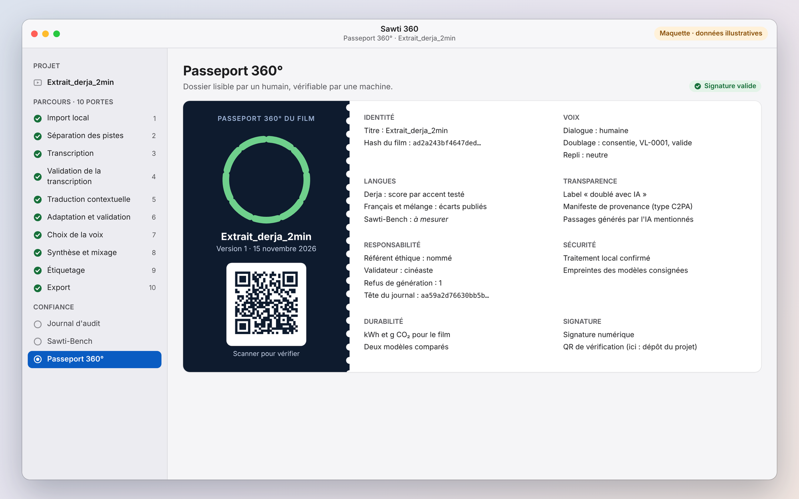
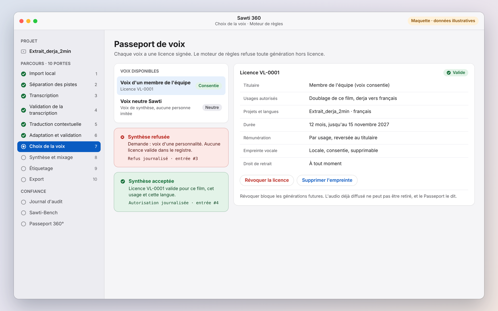
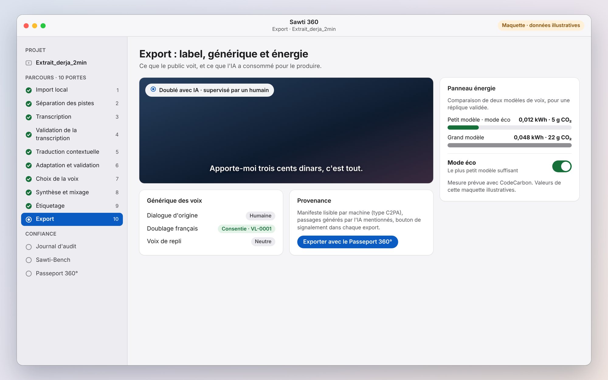
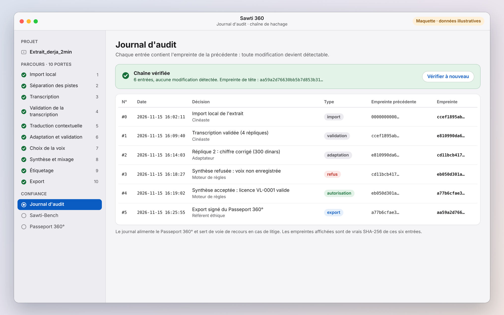
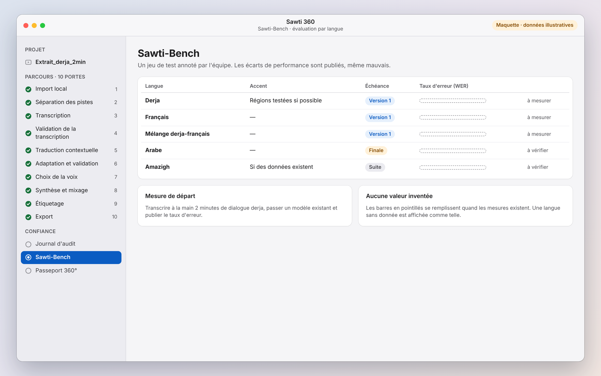

# Sawti 360 — Le doublage de confiance

*Faire voyager les œuvres tunisiennes en derja, avec un doublage éthique et supervisé par des humains.*

Sawti 360 double une œuvre de la derja vers le français : un film, mais aussi une vidéo YouTube, un Short ou un podcast. L'IA propose, le créateur décide. Chaque voix a un Passeport de voix : sans consentement, rien n'est généré. À l'export, l'œuvre part avec un Passeport 360° que chacun peut vérifier.

« L'IA propose · L'humain décide · La confiance accompagne chaque export. »

Hackathon IA Éthique 360, 5e édition (Junior Entreprise INSAT et OIF) · première soumission du 15 novembre 2026.

*Maquette du prototype, données illustratives, aucune voix réelle.*

**Ce qui est nouveau :** les outils de doublage par IA produisent une voix. Sawti 360 produit une voix et la preuve qu'elle est légitime, mesurée et traçable.

## Sommaire

- [Où trouver chaque critère du cahier des charges](#où-trouver-chaque-critère-du-cahier-des-charges)
- [Le problème](#le-problème)
- [La solution](#la-solution)
- [Aperçu du prototype](#aperçu-du-prototype)
- [Vidéo de présentation](#vidéo-de-présentation)
- [Le Passeport 360° du film](#le-passeport-360-du-film)
- [Place de l&#39;IA : construit ou réutilisé](#place-de-lia--construit-ou-réutilisé)
- [Périmètre par échéance](#périmètre-par-échéance)
- [Démarche éthique à 360°](#démarche-éthique-à-360)
- [En cohérence avec la Francophonie](#en-cohérence-avec-la-francophonie)
- [Modèle économique](#modèle-économique)
- [Design de l&#39;interface](#design-de-linterface)
- [Équipe](#équipe)
- [Propriété intellectuelle](#propriété-intellectuelle)
- [Sources](#sources)

## Où trouver chaque critère du cahier des charges

Première soumission du 15 novembre, avec les pondérations du cahier des charges.

| Critère (poids)                                                       | Où le lire                                                                                                                |
| ---------------------------------------------------------------------- | -------------------------------------------------------------------------------------------------------------------------- |
| Pertinence du problème détecté (30 %)                               | [Le problème](#le-problème)                                                                                               |
| Innovation et place de l'IA (25 %)                                     | [La solution](#la-solution), [Place de l&#39;IA](#place-de-lia--construit-ou-réutilisé)                                    |
| Démarche éthique à 360° (25 %)                                     | [Démarche éthique à 360°](#démarche-éthique-à-360)                                                                   |
| Faisabilité et intention de développement (20 %)                     | [Périmètre par échéance](#périmètre-par-échéance), [Équipe](#équipe), [Aperçu du prototype](#aperçu-du-prototype) |
| Livrable : README détaillé en français avec section éthique        | Ce fichier                                                                                                                 |
| Livrable : vidéo de 1 à 2 minutes en français                         | [Vidéo de présentation](#vidéo-de-présentation)                                                                           |
| Propriété intellectuelle : droits d'auteur, voix, licences           | [Propriété intellectuelle](#propriété-intellectuelle)                                                                   |
| Phases suivantes : impact francophone, viabilité, modèle économique | [Francophonie](#en-cohérence-avec-la-francophonie), [Modèle économique](#modèle-économique)                             |

## Le problème

Un cinéaste tunisien indépendant rencontre une barrière de langue qui empêche ses films en derja d'être compris quand ils sont présentés à des festivals ou à des publics étrangers, ce qui entraîne des films primés mais invisibles. Les outils d'IA qui pourraient les doubler lui font courir un autre risque : voix clonées sans accord, contenus non étiquetés, aucune trace de qui a décidé quoi.

**Face 1 : le film ne voyage pas.** Lors de l'entretien du 14 novembre 2026, le cinéaste tunisien Mohamed Karim Dahmouni a expliqué que les sous-titres aident, mais que le doublage permet à un film de voyager. Toute utilisation de son image ou de sa voix dans le projet est conditionnée à un accord écrit.

> « Un film que le public ne comprend pas reste invisible, même s'il est extraordinaire. Les miens sont en dialecte tunisien, ils s'arrêtent à la barrière de la langue. Les sous-titres aident un peu, mais seul le doublage permet à un film de voyager. »
> Mohamed Karim Dahmouni, cinéaste, entretien du 14 novembre 2026 et vidéo de témoignage (accord écrit d'image et de voix : à obtenir)

**Face 2 : le doublage par IA est un terrain de conflits.** Les fiches du programme AI Academy citent des cas réels : en France, la voix d'un doubleur décédé recréée par IA pour une bande-annonce alors que sa famille n'avait accepté qu'un essai, puis 25 doubleurs qui obtiennent le retrait de 47 modèles clonant leur voix ; des doublages d'anime par IA mis en ligne puis retirés en quelques jours ; une voix synthétique dans un documentaire sans mention à l'écran. La technique seule ne suffit pas : il faut du consentement, de la transparence et de la responsabilité.

**Notre démarche.** Le constat s'appuie sur l'entretien avec Mohamed Karim Dahmouni et sur les difficultés de consentement, de transparence et de traçabilité documentées dans le secteur. Le WER est l'indicateur retenu pour évaluer la transcription du derja ; aucun résultat chiffré n'est avancé dans ce README.

| Personne interrogée              | Date             | Enseignement retenu                                                                                            |
| --------------------------------- | ---------------- | -------------------------------------------------------------------------------------------------------------- |
| Mohamed Karim Dahmouni, cinéaste | 14 novembre 2026 | Un film que le public ne comprend pas reste invisible ; les sous-titres aident un peu, mais seul le doublage permet à un film de voyager. |

Des échanges complémentaires avec des programmateurs, doubleurs, traducteurs et producteurs permettront d'enrichir ce premier retour. Ils ne sont pas présentés ici comme déjà réalisés.

**Au-delà du cinéma.** Le même blocage touche les créateurs en ligne : une vidéo YouTube, un Short, un podcast ou une vidéo générée par IA en derja reste dans le public qui comprend la derja. Le parcours et la couche de confiance sont les mêmes ; seul l'usage déclaré dans le Passeport de voix change (`doublage_video_en_ligne` : YouTube, Shorts, Reels, podcasts). C'est une hypothèse que nous n'avons pas encore vérifiée sur le terrain : l'entretien avec un vidéaste ou un podcasteur est à recueillir (voir [docs/ENTRETIENS.md](docs/ENTRETIENS.md)).

## La solution

Sawti 360 est un doublage supervisé entouré d'une couche de confiance. Les outils de doublage par IA produisent une voix. Sawti 360 produit une voix et la preuve qu'elle est légitime, mesurée et traçable.

### Le parcours d'un film : dix étapes, dix portes de confiance

| #  | Étape                         | Ce qui se passe                                                                                | Porte de confiance |
| -- | ------------------------------ | ---------------------------------------------------------------------------------------------- | ------------------ |
| 1  | Import local                   | Le cinéaste charge un extrait ; rien ne quitte sa machine                                     | Sécurité         |
| 2  | Séparation des pistes         | Dialogue séparé de la musique et de l'ambiance                                               | Durabilité        |
| 3  | Transcription                  | Derja, français et mélange, score de confiance par segment                                   | Diversité         |
| 4  | Validation de la transcription | Le cinéaste ou un transcripteur corrige                                                       | Contrôle humain   |
| 5  | Traduction contextuelle        | Propositions avec glossaire culturel, vérificateur de fidélité (chiffres, noms, négations) | Robustesse         |
| 6  | Adaptation et validation       | L'adaptateur accepte, réécrit ou rejette chaque réplique                                    | Responsabilité    |
| 7  | Choix de la voix               | Voix neutre ou consentie ; le moteur de règles vérifie le Passeport de voix                  | Consentement       |
| 8  | Synthèse et mixage            | Voix générée avec le plus petit modèle suffisant                                           | Durabilité        |
| 9  | Étiquetage                    | Label visible, métadonnées, générique des voix                                             | Transparence       |
| 10 | Export                         | Piste doublée, sous-titres et Passeport 360° signé                                          | Toutes les portes  |

Le périmètre de chaque étape par échéance est dans [Périmètre par échéance](#périmètre-par-échéance).

### Les neuf modules de la couche de confiance

| Principe                | Module Sawti 360                       | Ce que fait le module                                                                                                                              |
| ----------------------- | -------------------------------------- | -------------------------------------------------------------------------------------------------------------------------------------------------- |
| Contrôle humain        | Validation et bouton d'arrêt          | Validation de chaque réplique ; rien ne sort sans validation                                                                                      |
| Consentement            | Passeport de voix et moteur de règles | Registre des consentements (qui, quel usage, combien de temps, quelle rémunération, droit de retrait) ; refus de toute génération hors licence |
| Équité d'accès       | Équité d'accès                      | Mesure des écarts par accent régional ; version gratuite pour étudiants et petites structures                                                   |
| Diversité              | Sawti-Bench                            | Test en français, derja, arabe, amazigh si des données existent ; publication des écarts, même mauvais                                         |
| Transparence            | Label et générique des voix          | Label visible, manifeste lisible par machine de type C2PA, générique, QR de vérification                                                        |
| Responsabilité         | Journal d'audit et référent éthique | Journal à chaîne de hachage, référent éthique nommé, voie de recours                                                                         |
| Robustesse              | Garde-fous et équipe rouge            | Blocage des voix non enregistrées et des personnalités, tests d'attaque, bouton de signalement                                                   |
| Sécurité des données | Coffre local                           | Traitement local, chiffrement, accès par rôle, jamais de film inédit envoyé à une IA publique                                                 |
| Durabilité             | Panneau énergie                       | kWh et gCO₂ par génération, mode éco avec le plus petit modèle suffisant                                                                      |

Les fiches 1 et 3 du programme ne nous ont pas été transmises : « contrôle humain » et « équité d'accès » sont une hypothèse de notre part.

| Ce que fait l'IA                                                                       | Ce qu'elle ne décide pas                                                 |
| -------------------------------------------------------------------------------------- | ------------------------------------------------------------------------- |
| Elle propose une transcription                                                         | Le cinéaste valide le texte qui fait foi                                 |
| Elle propose une traduction et signale les écarts de chiffres, de noms, de négations | L'adaptateur accepte, réécrit ou rejette chaque réplique               |
| Elle génère une voix si le moteur de règles l'autorise                              | Le titulaire fixe les usages, les projets et la durée, et peut révoquer |
| Elle mesure sa consommation                                                            | Le référent éthique valide le passeport avant l'export                 |

## Aperçu du prototype

Ces huit écrans sont des **maquettes du prototype**, conçues avec les principes de l'Apple Human Interface Guidelines (voir [Design de l&#39;interface](#design-de-linterface)). Les données y sont illustratives et la bannière « Maquette · données illustratives » figure sur chaque image.

### 1. Parcours du film

Les dix portes de confiance et l'anneau des neuf modules. Rien ne sort sans validation humaine.

### 2. Transcription et validation

Score de confiance par segment et par langue ; les segments faibles sont signalés, pas masqués. Le bouton de validation reste inactif tant que le cinéaste n'a pas tout validé.

### 3. Traduction contextuelle et vérificateur de fidélité

Le vérificateur détecte ici un chiffre qui change (300 dinars devenus 30). L'adaptateur accepte, réécrit ou rejette, et sa décision est journalisée. Le glossaire culturel signale les expressions intraduisibles.

### 4. Passeport de voix et moteur de règles

Une voix non enregistrée est refusée, une voix consentie est acceptée. La révocation bloque les générations futures ; l'audio déjà diffusé ne peut pas être retiré, et l'interface le dit.

### 5. Export : label, générique et énergie

Label « doublé avec IA » visible, générique des voix (humaine, consentie, neutre), manifeste de provenance et comparaison énergétique de deux modèles.

### 6. Passeport 360°

Le dossier vérifiable par QR : identité, voix, langues, transparence, responsabilité, sécurité, durabilité, signature. Le QR de cette maquette pointe vers ce dépôt.

### 7. Journal d'audit à chaîne de hachage

Chaque entrée contient l'empreinte de la précédente. Les empreintes de la maquette sont de vrais SHA-256 calculés sur les six entrées affichées.

### 8. Sawti-Bench

Évaluation par langue. Aucune valeur n'est inventée : les barres en pointillés se remplissent quand les mesures existent.

## Vidéo de présentation

La vidéo de la première soumission dure 1 min 59, en français. Elle est construite en code avec [HyperFrames](https://github.com/heygen-com/hyperframes) (Apache-2.0) ; sa source est dans [video/](video/). Elle suit le fil du cahier : problème observé, solution, place de l'IA, démarche éthique.

| Temps | Scène |
| ----- | ----- |
| 0:00 | « Ahla bik ! » rebondit contre une vitre : la barrière de la langue |
| 0:07 | Témoignage de Mohamed Karim Dahmouni |
| 0:31 | Le problème et les obstacles d'aujourd'hui (studio, IA générique, film envoyé en ligne) |
| 0:42 | Pas seulement le cinéma : films, YouTube, Shorts, podcasts, vidéos générées par IA |
| 0:50 | Globe des langues : derja, puis français (aujourd'hui), puis arabe, anglais, espagnol (demain) |
| 1:00 | Une réplique réelle de la démo, de bout en bout : l'IA repère « 15 → 50 », le créateur corrige |
| 1:17 | Consentement sur la vraie console : refus, accord, refus après révocation |
| 1:36 | Passeport 360° signé et vérifié |
| 1:44 | Les six angles éthiques |
| 1:51 | La voix rejoint l'espace francophone ; L'IA propose · L'humain décide |

Le globe colore les pays où la langue est officielle ou d'usage courant ; il n'affiche aucun chiffre d'audience. Les écrans montrés sont les maquettes de l'interface (`docs/maquettes/`). La voix off est générée par IA avec ElevenLabs (voix « Chloé »), et le générique l'indique. Le fichier vidéo et le témoignage ne sont pas versionnés tant que l'accord écrit de Mohamed Karim Dahmouni n'est pas signé.

## Le Passeport 360° du film

À chaque export, Sawti 360 génère un dossier lisible par un humain et vérifiable par une machine. Un festival, un producteur ou un financeur peut le contrôler avec un QR, sans nous croire sur parole.

| Rubrique        | Contenu                                                                                                                             |
| --------------- | ----------------------------------------------------------------------------------------------------------------------------------- |
| Identité       | Titre, version, date, hash du film exporté                                                                                         |
| Voix            | Pour chaque voix : humaine, consentie ou neutre ; identifiant de licence ; usages autorisés ; durée ; état (valide ou révoqué) |
| Langues         | Scores de qualité par langue et par accent testé ; écarts publiés                                                               |
| Transparence    | Label, manifeste de provenance, mention des passages générés par l'IA                                                            |
| Responsabilité | Référent éthique, validateur, empreinte de tête du journal d'audit, nombre de refus de génération                             |
| Sécurité      | Versions et empreintes des modèles utilisés, traitement local confirmé                                                           |
| Durabilité     | kWh et gCO₂ pour le film, modèles comparés                                                                                       |
| Signature       | Signature numérique et QR de vérification                                                                                         |

## Place de l'IA : construit ou réutilisé

| Composant                        | Réutilisé ou construit                                                   | Évaluation prévue                                |
| -------------------------------- | -------------------------------------------------------------------------- | -------------------------------------------------- |
| Transcription derja et français | Réutilisé comme base ; adaptation légère si les données le permettent | WER avant et après, par langue, sur Sawti-Bench   |
| Traduction contextuelle          | Réutilisé, plus un glossaire construit avec des traducteurs              | Évaluation qualitative par des lecteurs bilingues |
| Vérificateur de fidélité      | Construit : règles, entités, rétro-traduction                           | Précision et rappel sur 100 erreurs injectées    |
| Moteur de consentement           | Construit : licences signées et règles                                   | Tests d'attaque, refus attendus                    |
| Détection de clone (Shield)     | À construire sur des empreintes vocales pré-entraînées                 | Taux d'erreur sur clones de test, publié          |
| Voix                             | Réutilisé (licence vérifiée), voix neutre ou consentie                 | Évaluation d'écoute de la qualité et du naturel |
| Filigrane et manifeste           | Filigrane open source réutilisé ; manifeste construit                    | Robustesse après compression et bruit             |
| Panneau énergie                 | CodeCarbon réutilisé                                                     | kWh et gCO₂ par minute de film                    |

La licence de chaque modèle et de chaque jeu de données est vérifiée avant utilisation. L'IA est au cœur de la solution, mais l'humain garde la décision à chaque étape.

## Périmètre par échéance

La plupart des modules de confiance sont de l'ingénierie, donc faisables vite. Les modèles lourds passent après.

| Échéance                              | À démontrer                                                                                                                                                      |
| --------------------------------------- | ------------------------------------------------------------------------------------------------------------------------------------------------------------------ |
| 15 nov., 23 h 59 (première soumission) | Passeport de voix et moteur de règles (refus et accord), label et manifeste, journal d'audit, panneau énergie, mesure de WER sur 2 min de derja, README éthique |
| 21 nov. (demi-finale)                   | Parcours complet sur un extrait de film : transcription, traduction, validation, voix, export, Passeport 360° ; retours des ateliers du 18 nov. intégrés        |
| 24 et 25 nov. (finale)                  | Sawti-Bench publié, équipe rouge, détection de clone, Passeport complet, Business Model Canvas                                                                  |
| Suite                                   | Amazigh, mode quasi-direct supervisé pour festivals, place de marché de voix sous licence : annoncés comme vision, pas comme acquis                             |

Maturité par module, telle que planifiée : V1 pour le Passeport de voix, le moteur de règles, le label, le journal d'audit, le panneau énergie et le blocage des voix non enregistrées ; demi-finale pour l'équité d'accès par accent ; finale pour l'équipe rouge, la détection de clone et la sécurité complète ; suite pour l'amazigh.

## Démarche éthique à 360°

Chaque principe du programme devient une fonction concrète, testable et visible dans le produit.

| Principe                | Cas et textes cités                                                                                                   | Module Sawti 360                       |
| ----------------------- | ---------------------------------------------------------------------------------------------------------------------- | -------------------------------------- |
| Consentement            | Doubleur recréé par IA (2025) ; 25 doubleurs obtiennent le retrait de 47 modèles (2026) ; RGPD art. 9 ; loi 2004-63 | Passeport de voix et moteur de règles |
| Diversité              | Common Voice et le kabyle ; Convention UNESCO 2005 ; AI Act art. 10                                                    | Sawti-Bench                            |
| Transparence            | Voix synthétique d'un documentaire sans mention (2021) ; AI Act art. 50(4) et 50(2)                                   | Label et générique des voix          |
| Responsabilité         | Doublages d'anime retirés (2025) ; AI Act art. 26 ; ISO/IEC 42001                                                     | Journal d'audit et référent éthique |
| Robustesse              | Fausse publicité avec un acteur (2023) ; AI Act art. 15                                                               | Garde-fous et équipe rouge            |
| Sécurité des données | Fuite de 1,1 To via un faux outil IA (2024) ; RGPD art. 32 et 33 ; loi 2004-63                                         | Coffre local                           |
| Durabilité             | Une vidéo IA de 5 s ≈ 3,4 MJ (MIT Technology Review, 2025) ; UNESCO 2021 ; AI Act annexe XI                          | Panneau énergie                       |

### Les six angles du cahier des charges

| Angle               | Où c'est traité                                        | Risque résiduel et mitigation                                                           |
| ------------------- | -------------------------------------------------------- | ---------------------------------------------------------------------------------------- |
| Les créateurs      | Validation humaine, crédit, générique des voix        | Validation par habitude : alertes ciblées et taux de détection mesuré                 |
| Les droits          | Passeport de voix, licences des modèles et des données | Une voix déjà diffusée ne peut pas être retirée : le dossier le dit clairement      |
| Les données        | Coffre local, datasheet, jeu de test documenté          | Jeu de test petit : limites publiées                                                    |
| Cultures et langues | Sawti-Bench, glossaire culturel, derja de premier plan   | Expressions intraduisibles signalées pour un choix humain                               |
| La transparence     | Label, manifeste, générique, QR                        | Un filigrane peut être retiré : le manifeste et le label restent la preuve             |
| La planète         | Panneau énergie, plus petit modèle suffisant           | Les modèles de voix sont les plus coûteux : une seule synthèse par réplique validée |

### Limites assumées

- Le projet s'inspire des textes cités sans prétendre constituer une certification juridique.
- La détection de clone n'est pas infaillible.
- Le périmètre dépend de la taille de l'équipe.
- Les principes 1 et 3 du programme ne nous ont pas été transmis : nous les avons traités comme « contrôle humain » et « équité d'accès », en attendant les fiches.

### Questions probables du jury

| Question                                                                   | Réponse                                                                                                                                                                                               |
| -------------------------------------------------------------------------- | ------------------------------------------------------------------------------------------------------------------------------------------------------------------------------------------------------ |
| N'est-ce pas un outil de doublage avec des autocollants de conformité ?   | Non : le moteur de règles refuse la génération sans licence valide, et le comportement est vérifiable dans le produit. Le Passeport est vérifiable par QR.                             |
| Différence avec les outils de traduction vocale des grandes plateformes ? | Ils existent. Notre apport : évaluation du derja avec nos données, contrôle humain mesuré, consentement appliqué, provenance et passeport. Nous ne prétendons pas battre leurs modèles de base. |
| L'humain valide-t-il vraiment ?                                            | Le prototype maintient une validation humaine obligatoire ; les alertes signalent les écarts à examiner avant export.                                                                                |
| Que deviennent les doubleurs ?                                             | Ils restent dans la boucle, crédités et rémunérés à l'usage ; aucune voix sans consentement écrit.                                                                                              |
| Le filigrane peut être retiré.                                           | Risque reconnu ; le manifeste signé et le label sont la preuve principale.                                                                                                                            |

## En cohérence avec la Francophonie

- **Diversité culturelle et linguistique** : le projet part de la derja, une langue à faibles ressources, et va vers le français. Nous mesurons la qualité langue par langue pour que l'écart soit visible. L'arabe est prévu pour la finale, puis l'amazigh, l'anglais et l'espagnol, pour que les créateurs touchent d'autres publics avec leur propre voix.
- **Jeunesse et entrepreneuriat** : rémunération par usage pour les comédiens de doublage et accès gratuit envisagé pour les étudiants et associations.
- **Inclusion et égalité** : l'outil vise les jeunes créateurs (cinéastes, vidéastes, podcasteurs) et les petites structures qui n'ont pas accès à un studio de doublage. L'export prévoit des sous-titres, utiles aux personnes sourdes ou malentendantes.
- **Un numérique au service de l'humain** : le consentement, les droits du titulaire et la liberté du cinéaste passent avant la génération : le moteur de règles refuse par défaut.

## Modèle économique

Business Model Canvas de première soumission.

| Bloc                  | Contenu                                                                                                                                                            |
| --------------------- | ------------------------------------------------------------------------------------------------------------------------------------------------------------------ |
| Segments              | Cinéastes et producteurs indépendants, festivals, ciné-clubs, chaînes locales, plateformes, comédiens de doublage                                             |
| Proposition de valeur | Faire voyager un film en derja avec contrôle humain et un Passeport 360° que festivals et financeurs peuvent vérifier ; protection des voix pour les comédiens |
| Canaux                | Festivals, écoles de cinéma, réseau INSAT, réseaux francophones, communauté en ligne                                                                          |
| Relation clients      | Accompagnement à la première utilisation, glossaire partagé, retours intégrés                                                                                 |
| Revenus               | Abonnement ou paiement à la minute de film ; offre festival ; offre gratuite pour étudiants et associations ; rémunération par usage reversée aux voix        |
| Ressources clés      | Modèles adaptés au derja, Sawti-Bench, glossaires, registre de voix consenties, équipe produit et ML                                                            |
| Activités clés      | Développement, annotation, évaluation, tests d'attaque, partenariats                                                                                             |
| Partenaires           | Adaptateurs, traducteurs, comédiens, festivals, studios, OIF, établissements d'enseignement                                                                      |
| Coûts                | Calcul, rémunération des humains qui valident, licences, hébergement sécurisé                                                                                 |

## Design de l'interface

Les maquettes suivent les [Human Interface Guidelines d&#39;Apple](https://developer.apple.com/design/human-interface-guidelines/) pour une application de bureau, avec la méthode du skill de design Apple : accessibilité d'abord, conventions de plateforme ensuite, puis identité.

- **Thèse de l'écran** : montrer, à chaque étape, quelle porte de confiance est franchie. Chaque écran affiche ce que l'IA a proposé et ce que l'humain a décidé.
- **Signature** : l'anneau à neuf segments, un par module de confiance. Il se remplit à mesure que les modules sont vérifiés et devient l'emblème du Passeport 360°. Sa structure encode une information réelle, pas une décoration.
- **Couleurs** : un sens par couleur. Vert pour valide ou consenti, rouge pour refusé, orange pour à vérifier, bleu pour l'action et l'étape en cours. L'état n'est jamais porté par la couleur seule : chaque pastille a un texte et une icône.
- **Contraste** (calculé sur les valeurs hexadécimales) : texte principal `#1D1D1F` sur `#F5F5F7` 15,5:1 ; texte secondaire `#58585D` sur `#F5F5F7` 6,5:1 ; vert `#17703A` sur `#E3F3E8` 5,3:1 ; rouge `#B8241B` sur `#FCE9E7` 5,4:1 ; orange `#8A4F00` sur `#FFF1D9` 5,9:1 ; blanc sur bleu `#0A5CC2` 6,3:1. Tous dépassent le seuil de 4,5:1.
- **Typographie** : une seule famille (Inter, proche de la police système), poids moyen à gras pour la hiérarchie, texte derja en écriture arabe de droite à gauche.
- **Honnêteté** : bannière « Maquette · données illustratives » sur chaque image, et aucune mesure inventée dans Sawti-Bench.

## Équipe

| Rôle                                 | Responsabilités                                                                  | Membre  |
| ------------------------------------- | --------------------------------------------------------------------------------- | ------- |
| Chef d'équipe et référent éthique | Entretiens de terrain, planning, livrables, journal d'audit, décisions éthiques | Ahmed   |
| IA parole                             | Transcription derja, Sawti-Bench, mesure du WER                                   | Youssef |
| IA langue                             | Traduction, glossaire, vérificateur de fidélité                                | Koussay |
| Back-end et sécurité                | Passeport de voix, moteur de règles, journal, coffre local, manifeste            | Amine   |
| Front-end, audio et communication     | Console, panneau énergie, voix et mixage, slides, vidéo, README                 | Ghayth  |

Au moins deux membres seront présents aux ateliers du 18 novembre.

## Propriété intellectuelle

L'équipe reste titulaire de la propriété intellectuelle du projet. Elle garantit que ses contributions sont originales et respectent les droits d'auteur, les droits à l'image et à la voix, et les licences des données et des modèles d'IA utilisés. Aucune voix ni image de personne n'est utilisée sans consentement écrit. L'OIF dispose d'un droit de premier regard sur les prototypes et livrables, comme le prévoit le cahier des charges.

## Sources

- Cahier des charges IA Éthique 360, 5e édition (JEI INSAT × OIF), JEI INSAT × OIF.
- Fiches AI Academy / Novation AI Center of Excellence : consentement, diversité, transparence, responsabilité, robustesse, sécurité des données et durabilité. Textes de référence : RGPD art. 9, 32 et 33 ; AI Act art. 10, 15, 26, 50 et annexe XI ; ISO/IEC 42001 ; UNESCO 2005 et 2021.
- Entretien avec Mohamed Karim Dahmouni, cinéaste, 14 novembre 2026.
- Article LREC 2024 sur la synthèse vocale du tunisien, langue à faibles ressources : [https://aclanthology.org/2024.lrec-main.1467](https://aclanthology.org/2024.lrec-main.1467).
- Apple Human Interface Guidelines : [https://developer.apple.com/design/human-interface-guidelines/](https://developer.apple.com/design/human-interface-guidelines/).

Ce dépôt n'affirme aucun résultat que l'équipe n'a pas mesuré, et il n'est pas un avis juridique.
