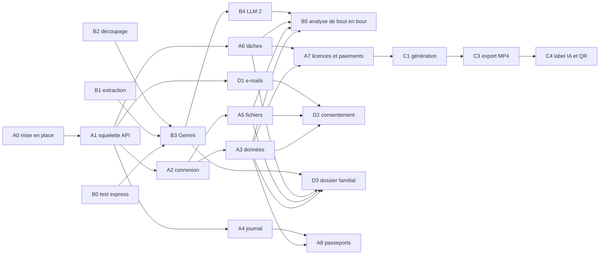

# Tâches

**P0** : indispensable à la démo de vendredi. **P1** : dès que le P0 de la piste est fini.
**P2** : après le hackathon, ou s'il reste du temps. Les durées supposent une personne
avec Claude Code. Cocher les cases dans les PR.

**Fini veut dire**, pour chaque tâche :
- `cd web && npm run typecheck && npm test` passe, avec des tests unitaires pour toute logique pure ajoutée ;
- vérifié sur l'aperçu Vercel de la PR, pas seulement en local ;
- avec `VITE_BACKEND=0`, les écrans touchés marchent toujours comme avant ;
- chaque action métier écrit son entrée de journal ; les étiquettes Réel / Simulé disent vrai ;
- aucun secret dans le code ; routes conformes à [API.md](API.md).

## Piste A : socle (Amine, compte Claude 1)

### A0. Mise en place (P0, 1 h, Amine + Koussay)
Tout [SETUP.md](SETUP.md) § 1 à § 6.
- [ ] schéma appliqué, 14 tables et 3 buckets privés visibles
- [ ] clés rangées dans Vercel (Production + Preview) et dans `web/.env.local`
- [ ] quotas réels de Groq et Gemini notés dans IA.md § 1

### A1. Squelette d'API (P0, 1 h 30) · dépend de A0
Fichiers : `web/api/index.ts`, `web/server/{app,env,db,errors}.ts`, `web/server/routes/{health,tts}.ts`,
`web/vercel.json`, `web/vite.config.ts`, `web/package.json`, `web/.env.example`, `web/tsconfig*.json`.
1. Dépendances d'ARCHITECTURE.md § 1.
2. `env.ts` : schéma zod de toutes les variables ; une clé absente rend son fournisseur `null`
   dans `/api/health`, elle ne fait pas planter l'API.
3. `app.ts` : `new Hono().basePath("/api")`, `onError` → `{ error, message }`, routes `health` et `tts`
   (portage d'`api/tts.ts`, même contrat). Imports relatifs avec `.js`.
4. `api/index.ts` : `const h = (req: Request) => app.fetch(req)` exporté en `GET`, `POST`,
   `PATCH`, `PUT`, `DELETE`. Supprimer `api/tts.ts` quand la route Hono répond.
5. `vercel.json` et plugin Vite (ARCHITECTURE.md § 2) ; `loadEnv` dans `process.env` en local.
6. Vérifier que `server/` et `api/` sont couverts par `npm run typecheck`.
- [x] `GET /api/health` répond en local et sur l'aperçu (local vérifié le 19/11 ; aperçu Vercel à contrôler au premier déploiement)
- [x] `POST /api/tts` se comporte comme avant (refus `THEME_INTERDIT_PAR_TITULAIRE` sur un texte politique avec la voix de Lina)
- [x] `GET /api/projects/x` renvoie un 401 JSON, pas la page HTML (la réécriture fonctionne ; `__path` testé, aperçu à contrôler)

### A2. Connexion (P0, 1 h 30) · dépend de A1
Fichiers : `src/lib/supabase.ts`, `src/state/remote/session.ts`, `src/pages/Auth.tsx` (branche back-end),
`server/auth.ts`, `server/routes/{demo,me}.ts`, `store.ts` (aiguillage de `login`, `signup`, `logout`), `ui/Shell.tsx`.
- [x] inscription : ligne `accounts` et 100 000 jetons créés par le déclencheur (testé sur Postgres avec `schema.sql` ; à revoir sur Supabase)
- [x] connexion, déconnexion, et boutons des comptes de démo (`/api/demo/session` + `verifyOtp`) — vérifiés dans Chromium avec le faux Supabase ; à revoir avec les clés
- [ ] mot de passe oublié : e-mail reçu, nouveau mot de passe accepté — code prêt ; demande le SMTP Gmail dans Supabase (SETUP.md § 2.5)
- [x] toute route protégée sans jeton → 401

### A3. Données partagées (P0, 2 h 30) · dépend de A2
Fichiers : `src/state/seed.ts`, `scripts/seed.ts` (+ script npm `seed`, SETUP.md § 7), `server/compose.ts`,
`server/routes/{bootstrap,projects,characters}.ts`, `src/api/{client,types}.ts`,
`src/state/remote/{bootstrap,projects,characters}.ts`, `store.ts`, `main.tsx`.
1. Sortir `seed()` de `store.ts` vers `src/state/seed.ts` **sans changer son contenu** ; le mode simulé l'importe.
2. `scripts/seed.ts` (idempotent) : crée les comptes de démo (`auth.admin.createUser`,
   `email_confirm: true`, `DEMO_PASSWORD`, nom et organisation), puis insère ce que produit
   `seed()` : projets de Nour, demandes de licence, profils (Lina → son compte ; Sami, Maya,
   Hédi → profils fictifs sans compte), licences signées, usages, notifications, consentement
   et dossier de « Hkeyet Jeddi », journal rejoué par `appendAudit`, passeport de « Bledi » (après A8).
3. `GET /api/bootstrap` : formes exactes d'API.md § 2 ; le store pose `spent = PLANS[plan].monthly − balance`
   pour que `balanceOf()` reste inchangé.
4. Store en mode back-end : hydratation après connexion et au retour sur l'onglet ; `persist`
   ne garde que `persona` et `currentId`.
5. Routes projets, segments, personnages (API.md), avec leurs entrées de journal.
- [x] connecté en Nour Films, le tableau de bord est identique à la version simulée (Chromium, base locale + faux Supabase ; à revoir sur Supabase)
- [x] une traduction modifiée sur l'ordinateur apparaît sur le téléphone après rafraîchissement (rechargement vérifié dans Chromium)
- [x] supprimer un projet importé marche ; supprimer un exemple est refusé (testé sur l'API)

### A4. Journal côté serveur (P0, 1 h) · dépend de A1
Fichiers : `server/audit.ts` (ARCHITECTURE.md § 3), `server/routes/journal.ts`, `src/state/remote/journal.ts`, `pages/Trust.tsx`.
- [x] test : 10 ajouts en parallèle donnent une chaîne liée ; `verifyChain()` du navigateur la valide
- [x] le centre de confiance affiche le journal de la base ; la falsification simulée est détectée (Chromium, mode back-end)

### A5. Fichiers (P0, 45 min) · dépend de A2
Fichiers : `server/storage.ts`, `server/routes/uploads.ts`, `src/api/upload.ts`.
- [x] audio, image, dossier et échantillon s'envoient aux bons chemins (API.md) (envoi réel vérifié dans Chromium avec le faux stockage)
- [x] mauvais type → 400 ; trop gros → 413 ; projet d'un autre compte → 403
- [x] envoi public accepté seulement avec un jeton de consentement valide

### A6. Tâches longues (P0, 45 min) · dépend de A1
Fichiers : `server/jobs.ts`, `server/routes/jobs.ts`, `src/api/useJob.ts`.
- [x] une tâche de test passe de `queued` à `running` puis `done`, étapes visibles par interrogation
- [x] une tâche bloquée depuis plus de 300 s est lue comme `error` et peut être relancée

### A7. Licences et paiements (P0, 2 h) · dépend de A3, A6 (et D1 pour l'e-mail)
Fichiers : `server/routes/{voices,licences,payments}.ts`, `server/ledger.ts`,
`src/state/remote/{licensing,payments}.ts`, `pages/licensing.tsx`, `pages/PublicResponses.tsx`
(`LicenseResponsePage` seulement), `pages/Owner.tsx` (`OwnerRequests`), `pages/Requests.tsx`, `pages/Library.tsx`.
- [ ] demande → titulaire notifié et e-mail → acceptation (connecté, et par le lien sur un autre appareil)
- [ ] « Payer » confirme tout de suite, « 0 DT débité · prototype » ; la voix devient utilisable
- [ ] changer de plan crédite les jetons du plan ; le solde affiché suit le registre
- [ ] demande expirée (bouton de démo) ou refusée → la voix reste bloquée, alternatives proposées
- [ ] deuxième décision sur le même lien → 409

### A8. Signatures et passeports (P0, 1 h 30) · dépend de A3, A4
Fichiers : `scripts/keys.ts`, `server/sign.ts`, `src/core/crypto.ts`, `src/state/passportBuild.ts`,
`server/routes/passports.ts`, `pages/Passport.tsx` (`Verify` avec `?id=`), `pages/project/Result.tsx` (QR court).
1. `crypto.ts` : la clé publique vient de `VITE_SAWTI_PUBLIC_KEY` (navigateur) ou de la graine
   (serveur) ; la clé de démo ne sert plus qu'en mode simulé.
2. `buildPassport()` sort de `store.ts` en fonction pure `src/state/passportBuild.ts`,
   utilisée par le store simulé et par le serveur.
- [ ] passeport signé par le serveur vérifié dans le navigateur ; un champ modifié → signature invalide
- [ ] `/verifier?id=S360-…` marche sur un téléphone (QR) ; les anciens liens `#p=` restent vérifiables en mode simulé
- [ ] licences signées par le serveur acceptées par `verifyLicense()` dans `runGate`

### A9. Notifications (P1, 45 min) · dépend de A3
Fichiers : `server/notify.ts`, `server/routes/notifications.ts`, `src/state/remote/notifications.ts`, `ui/Shell.tsx`.
- [ ] chaque événement du tableau de la spéc. § 8 notifie le bon compte, dans le bon espace
- [ ] la cloche se met à jour en 15 s au plus sur un autre appareil ; « tout lu » fonctionne

### A10. Espace propriétaire (P1, 1 h) · dépend de A7, A8 (et B7 pour le contrôle du texte lu)
Fichiers : `server/routes/owner.ts`, `src/state/remote/owner.ts`, `pages/Owner.tsx`.
- [ ] création du Passeport de voix, profil et tarif, règles signées à nouveau
- [ ] révocation : créateurs notifiés, génération suivante refusée (`LICENCE_REVOQUEE`) ; rétablissement

## Piste B : IA (Youssef pour la parole, Koussay pour la langue, compte Claude 2)

### B0. Test express sur nos extraits (P0, 1 h, Youssef + Koussay) · dépend de A0 (clés)
Protocole d'IA.md § 8.0. Cinq à dix extraits enregistrés par l'équipe jeudi soir, avec leur
transcription écrite à la main. À faire avant de figer B3.
- [ ] WER et CER de chaque transcripteur sur nos extraits ; notes à l'aveugle Gemini / Claude pour la traduction
- [ ] configuration retenue écrite dans IA.md § 1 (`GEMINI_ASR_MODEL`, `GEMINI_MODEL`, `CLAUDE_MODEL`)

### B1. Extraction dans le navigateur (P0, 1 h 30) · sans dépendance
Fichier : `src/media/extract.ts` (ARCHITECTURE.md § 4.2).
- [x] sur un MP4 H.264/AAC et un WebM de 2 min : audio Ogg/Opus de moins de 1 Mo, lisible ; 60 images au plus (276 Ko, 60 images de 6 Ko, Chromium)
- [ ] moins de 20 s sur un portable ; Chrome et Firefox ; repli WAV si Opus n'est pas encodable — Chromium : 2,5 s, repli WAV vérifié (3,7 Mo) ; Firefox à essayer

### B2. Découpage par Groq Whisper (P0, 1 h) · sans dépendance
Fichiers : `server/ai/groq.ts`, `server/ai/prompts.ts` (`ASR_PROMPT`), `scripts/try-asr.ts`.
- [x] segments `s1, s2…` avec `start` et `end` ; texte de Whisper gardé comme simple indice ; silences écartés ; segments trop courts fusionnés (testé avec un faux Groq ; vrai appel : clé GROQ_API_KEY)
- [x] une erreur du fournisseur remonte typée, pour la chaîne de repli

### B3. Analyse Gemini (P0, 2 h) · dépend de B2
Fichiers : `server/ai/gemini.ts`, `server/ai/schemas.ts`, `server/ai/prompts.ts` (prompt § 4.2 et glossaire), `scripts/try-analysis.ts`.
- [ ] sur l'extrait de démo : deux intervenants, prénom proposé seulement s'il est entendu ou écrit
- [ ] la derja est écrite par Gemini en écoutant l'audio (pas une retouche du texte de Whisper) ; intervalles sans parole retirés
- [x] identifiants et horodatages inchangés ; nombres et négations conservés ; `fits` calculé (contrôles du code testés ; la qualité de Gemini se mesure en B0)
- [x] replis : Gemini seul (IA.md § 4.6) ; Groq texte seul (chaîne testée avec de faux fournisseurs)

### B4. Relecture LLM 2 (P0, 1 h) · dépend de B3
Fichiers : `server/ai/{review,claude}.ts`, `server/routes/review.ts`, `src/state/remote/review.ts`,
`src/mock/simulate.ts` (type `Review` : `simulated: boolean`, `provider?`), `pages/project/Translation.tsx`.
- [x] chaîne Claude → Groq → règles vérifiée en retirant les clés une à une (faux fournisseurs ; refus de Claude → Groq)
- [x] erreurs injectées (30 dinars au lieu de 300, négation perdue) signalées ; « Appliquer » marche (route testée sur Postgres)

### B5. Analyse de bout en bout (P0, 1 h 30) · dépend de A3, A5, A6, B1 à B4
Fichiers : `server/routes/analysis.ts`, `src/media/pipeline.ts` (branche back-end), `pages/project/Analysis.tsx`, `pages/NewProject.tsx`.
- [ ] sur l'aperçu déployé, l'extrait de démo donne de vrais segments, personnages, traductions et relectures en moins de 2 min — chaîne vérifiée de bout en bout en local (navigateur → stockage → tâche → projet, 5 s jusqu'à l'IA) ; IA réelle : clés Groq et Gemini
- [x] étapes qui avancent, étiquettes « Réel » avec les noms des modèles (étapes écrites dans projects.pipeline, testé avec de faux fournisseurs)
- [x] réimport du même fichier : résultat repris sans rappeler l'IA
- [x] en cas d'échec : « Relancer » et « Utiliser l'exemple simulé » (Chromium, mode back-end)

### B7. Contrôle de l'échantillon de voix (P1, 1 h) · dépend de B2, A5, A6
Fichiers : `server/ai/voicecheck.ts`, `server/ai/wer.ts` (+ tests).
- [ ] lecture du paragraphe → WER ≤ 0,25 → « Correspondance » ; autre texte → « Non conforme »

### B8. Sawti-Bench minimal (P1, 2 h, Youssef) · dépend de B2, B3
Protocole d'IA.md § 8 ; affichage avec D4.
- [ ] WER et CER réels par fournisseur, avec date et effectif ; chiffres défavorables publiés aussi

### B9. Transcription auto-hébergée (P2) : la meilleure qualité pour la derja
Un Whisper affiné sur le tunisien atteint 14 à 22 % d'erreurs à NADI 2026, contre 85 % sans
adaptation (IA.md § 1 bis). Candidats ouverts : FarukSTT (large-v3 tunisien, GPU conseillé),
`TuniSpeech-AI/whisper-tunisian-dialect` (large-v2), `whisper-small-tunisian-derja-ct2`
(faster-whisper sur CPU, via `sawti/asr.py`). Hébergement sur un Space Hugging Face, comparé
dans Sawti-Bench ; licence de chaque modèle vérifiée avant usage.

## Piste C : voix, génération, export (Ghayth, compte Claude 3)

### C1. Génération côté serveur (P0, 2 h) · dépend de A3, A6, A7
Fichiers : `server/ai/elevenlabs.ts`, `server/routes/generation.ts`, `server/ledger.ts` (avec A7),
`src/state/remote/generation.ts`, `pages/project/Generation.tsx`, `src/mock/simulate.ts` (`GEN_STAGES` : étapes honnêtes).
- [ ] chaque réplique approuvée est synthétisée, ou refusée avec sa raison (ARCHITECTURE.md § 4.9)
- [ ] audio rangé ; jetons débités ; 70 % crédités au titulaire ; journal ; notification « Votre voix a été utilisée »
- [ ] thème interdit → titulaire notifié ; solde insuffisant → 402 expliqué
- [ ] passeport signé à la fin, notification « Rendu prêt »

### C2. Ajustement du débit (P1, 1 h) · dépend de C1
- [ ] une réplique volontairement longue est accélérée (jusqu'à 1,15) ou signalée « trop longue » avec une version courte proposée

### C3. Export MP4 (P0, 2 h) · essai sans dépendance, vraies répliques après C1
Fichiers : `src/media/export.ts`, `pages/project/Result.tsx`.
- [ ] le MP4 se lit dans VLC, Chrome et sur un téléphone ; voix françaises à leur place, original atténué
- [ ] vidéo copiée sans réencodage ; extrait de 2 min exporté en moins de 30 s
- [ ] vidéo source lue dans IndexedDB (et dans Storage si l'original a été envoyé)

### C4. Label IA et QR dans la vidéo (P1, 1 h 30) · dépend de C3, A8
- [ ] film et podcast : label pendant 4 s au début, QR pendant 5 s à la fin, scanné par un téléphone → passeport vérifié
- [ ] Reel/Short : rien d'ajouté, « règle à confirmer » affiché

### C5. Aperçus (P0, 45 min) · dépend de C1
Fichiers : routes `synthesize` et `preview`, `store.ts` (`generate`, `tryVoice`), `pages/project/Timeline.tsx`, `pages/Library.tsx`.
- [ ] l'aperçu de la timeline joue l'audio du serveur ; réplique non approuvée refusée
- [ ] écoute d'échantillon dans la bibliothèque ; voix révoquée refusée

### C6. Clonage de voix consentie (P2, 2 h) · ElevenLabs Starter
- [ ] la voix d'un membre de l'équipe, clonée depuis son propre échantillon, sert à la génération
- [ ] la révocation supprime la voix chez ElevenLabs ; étiquette « voix clonée avec consentement »

## Piste D : autorisations, e-mails, confiance, recette (Ahmed, compte Claude libre)

### D1. E-mails (P0, 1 h) · dépend de A1
Fichiers : `server/mail.ts` et ses gabarits (consentement, demande de licence, décision, rendu prêt),
composant « Copier le lien » + « Envoyer par WhatsApp ».
- [ ] les e-mails arrivent dans Gmail avec des liens qui marchent
- [ ] si l'envoi échoue, la route réussit quand même et renvoie le lien (`mail: false`)

### D2. Consentement d'une personne vivante (P0, 1 h 30) · dépend de A3, A5, D1 (B7 en P1)
Fichiers : `server/routes/consents.ts`, `src/state/remote/consents.ts`,
`pages/project/Authorizations.tsx` (partie vivante), `pages/PublicResponses.tsx` (`ConsentPage`).
- [ ] le lien s'ouvre sur un autre appareil ; une personne non inscrite enregistre et crée son Passeport de voix
- [ ] accord → « Autorisée » sur l'écran du créateur en 15 s au plus ; refus → bloquée
- [ ] lien déjà utilisé → 409 ; un nouvel envoi remplace l'ancien lien

### D3. Dossier familial (P0, 2 h) · dépend de A3, A5, A6, B3
Fichiers : `server/ai/dossier.ts` (IA.md § 4.4), `server/routes/dossiers.ts`, `src/state/remote/dossiers.ts`,
`pages/project/Authorizations.tsx` (partie décédée), `src/state/workflow.ts` (`FamilyCheck.simulated: boolean`).
Préparer jeudi soir trois documents écrits par l'équipe (PDF ou photo) :
(1) « J'autorise l'utilisation de la voix de feu Mohamed B., le conteur de l'épisode (le grand-père) » ;
(2) le même avec le rôle de la narratrice ; (3) une page sans rôle, ou une photo floue.
- [ ] (1) → Correspondance détectée → validation ; (2) → Incohérence détectée ; (3) → Vérification nécessaire
- [ ] tests unitaires des règles déterministes
- [ ] le document n'apparaît nulle part en public ; le passeport ne montre que la référence et le statut

### D4. Centre de confiance (P1, 1 h) · dépend de A1, A4, B8
Fichier : `pages/Trust.tsx`.
- [ ] « Modèles et versions » rempli par `/api/health` ; portes et modules à jour
- [ ] panneau énergie depuis les usages mesurés ; Sawti-Bench depuis les résultats de B8
- [ ] plus aucun « Simulé » pour ce qui est réel ; « Prévu » gardé pour la synchro labiale, la séparation et les kWh

### D5. Recette et démonstration (P0, en continu, Ahmed)
Vendredi 17 h, en production, sur ordinateur et téléphone :
- [ ] `/api/health` : tous les fournisseurs renseignés
- [ ] comptes de démo, inscription, connexion, déconnexion, mot de passe oublié
- [ ] import de l'extrait → analyse réelle en moins de 2 min (étapes, images, segments, personnages)
- [ ] confirmation des personnages inscrite au journal
- [ ] vivant : e-mail reçu, page sur le téléphone, Passeport de voix créé, accord → l'ordinateur se met à jour
- [ ] décédé : trois documents, trois résultats ; validation possible seulement après correspondance
- [ ] bibliothèque : écoute, demande à Lina acceptée en étant connecté, demande à Sami par le lien, expiration, refus
- [ ] paiement gratuit → licence utilisable ; changement de plan → jetons crédités ; soldes cohérents
- [ ] traduction : LLM 1, corrections du LLM 2, application, approbations au journal
- [ ] timeline : aperçu audio ; réplique non approuvée refusée
- [ ] génération → résultat ; refus expliqués ; titulaire notifié de l'usage de sa voix
- [ ] MP4 lu sur ordinateur et téléphone ; label IA et QR (si C4 fini)
- [ ] passeport : QR scanné → signature vérifiée ; champ modifié → invalide
- [ ] centre de confiance : chaîne valide, falsification détectée, modèles réels
- [ ] mobile 375 px : aucun débordement horizontal sur les écrans du parcours
- [ ] un déploiement avec `VITE_BACKEND=0` prêt à être promu si la production casse pendant la démo
- [ ] quotas vérifiés le matin même (Gemini, Groq, crédits ElevenLabs)

## Ordre de fusion conseillé vendredi

A1 → A2 → (A3, A4, A5, A6) → (B5, A7, D2, D3) → C1 → A8 → (C3, C5) → (A9, A10, B7, C2, C4, D4, B8).
Chaque fusion déclenche un déploiement : contrôler l'aperçu avant de fusionner la suivante.
